# DSH 飞书插件 · 用户使用指南

在 DSH 中查看飞书任务、进入对应会话，并用「今日洞察」安排工作。

> 本文合并既有说明，截图来自不同界面版本，按钮位置以实际面板为准。部分原图含内部项目与任务信息，仅供内部使用；标注「脱敏」的图片也未重新审查，请勿直接外发。

## 1. 打开面板，找到任务

打开 DSH 侧边面板中的「飞书」：上方是今日洞察，下方是任务列表或看板。按状态、优先级筛选，或按工作区分组。

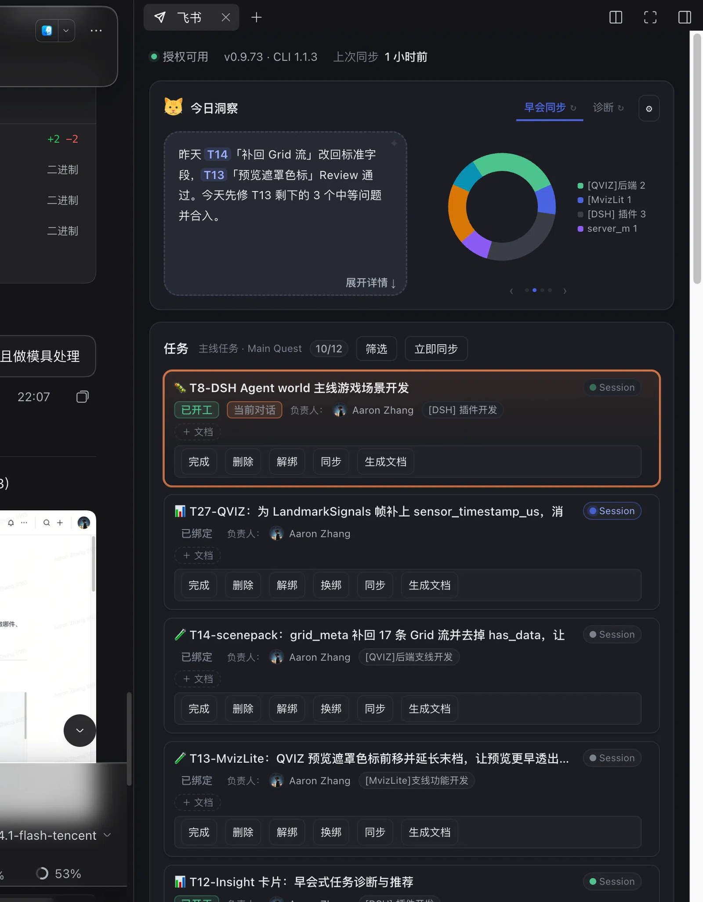

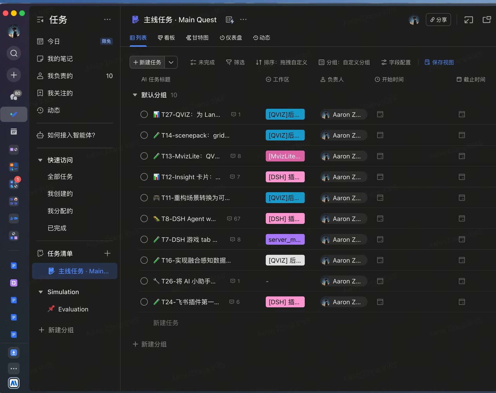

## 2. 看洞察，确定下一步

「早会同步」看工作摘要，「诊断」看问题与建议。切换标签只换视图；点击标签的 `↻` 才重新生成。图表用 `‹` / `›` 切换；点击「展开详情」查看每条任务的第一步。

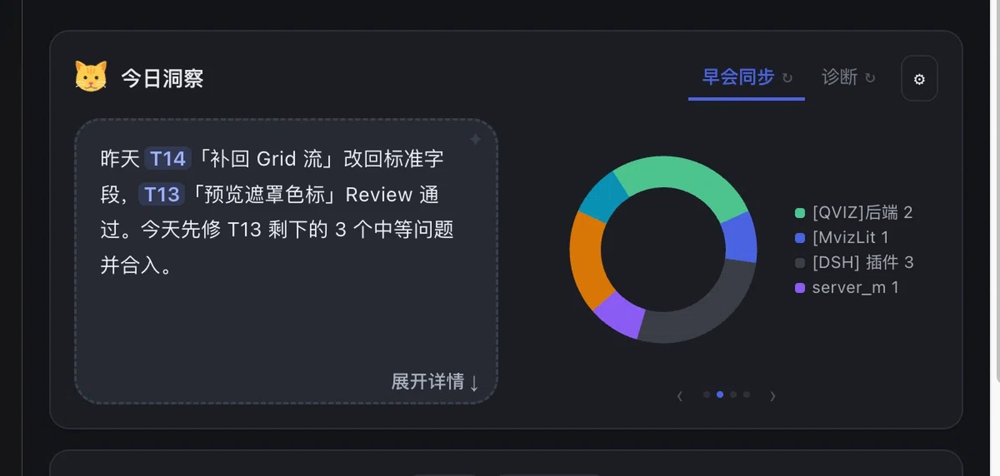

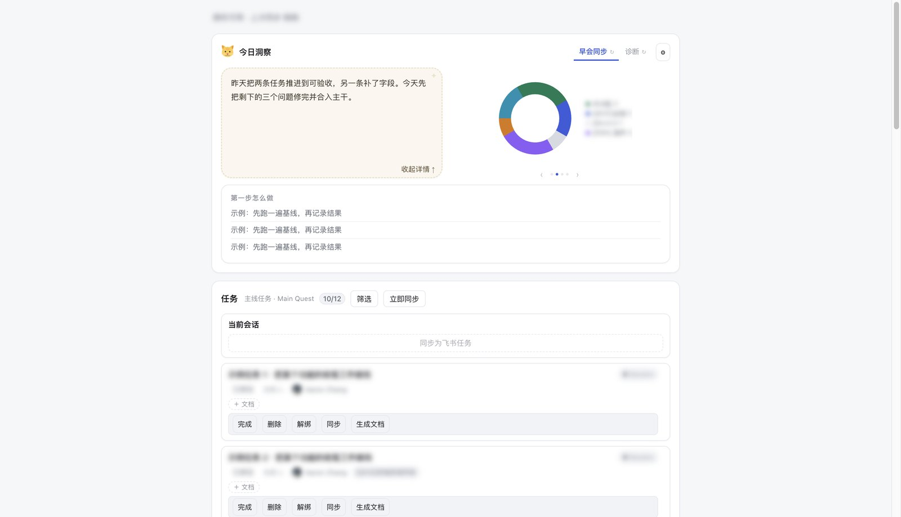

## 3. 进入会话，处理任务

点击任务卡的 `Session` 进入对应会话；标题悬停查看全名，双击改名。当前会话对应的任务会置顶，并显示橙色「当前对话」标记。

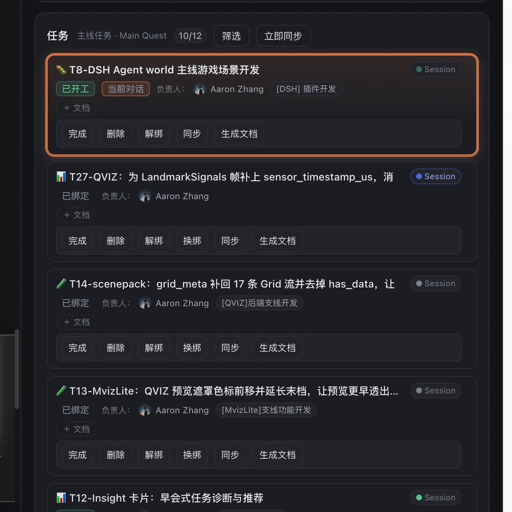

**会话指示灯：**蓝色呼吸＝正在回复；绿色实心＝已跑完、尚未查看；淡绿色＝空闲、已查看；灰色＝会话已结束。会话跑完不代表飞书任务已完成。

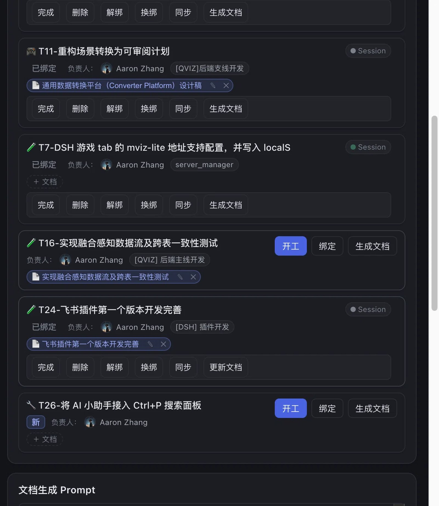

| 操作 | 作用 |
| --- | --- |
| ＋ 文档 | 把会话里的文档关联到任务 |
| 生成文档 | 为任务新建飞书文档 |
| 同步 | 按最后修改时间决定写回或拉取 |
| 完成 | 将飞书任务置完成，并归档会话 |
| 删除 | 只归档会话，飞书任务状态不变 |
| 解绑 | 断开任务与会话关联，任务回到未开工 |

## 4. 调整洞察设置

点击洞察右上角 `⚙`，修改标签名称、提示词或添加自定义标签；点击「完成」保存。「忽略的任务关键词」命中的任务不发送给 AI，旧版默认忽略 `DSH`。面板随 DSH 主题切换浅色／深色。

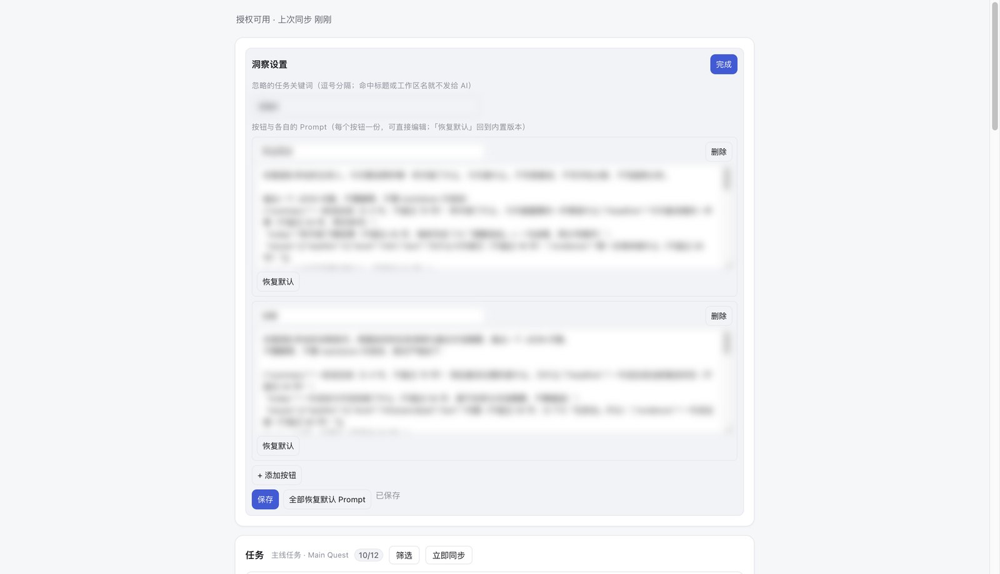

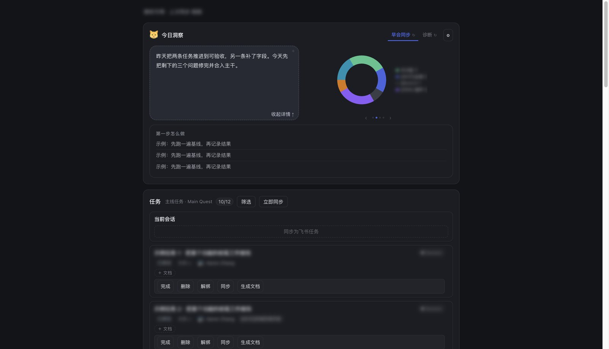

## 5. 常见问题

- **洞察为空？**当天首次打开会自动生成；原说明预计约 15 秒。之后需点击对应标签的 `↻` 重新生成。
- **已完成筛选为空？**原说明中的版本不拉取飞书历史已完成任务，只保留在面板中标记完成的任务及关联会话。
- **尚未开始执行，为什么是进行中？**绑定会话即视为进行中，讨论也算推进。
- **T13 等编号是什么？**建议中的任务索引，以旁边的任务名识别即可。

## 附录：其他原始截图

正文只保留一组操作配图，其余不同截图集中于此；完全相同的图片仅保留一次。截图标题中的脱敏状态沿用原文标注，不代表已验证可外发。

### 浅色界面（原文标注已模糊） · 长什么样

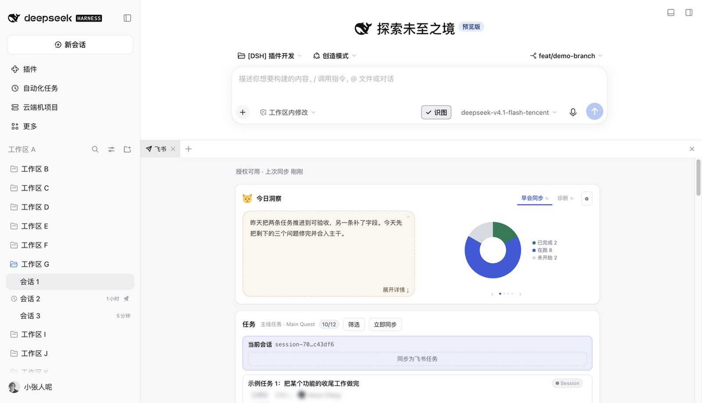

### 浅色界面（原文标注已模糊） · 任务卡

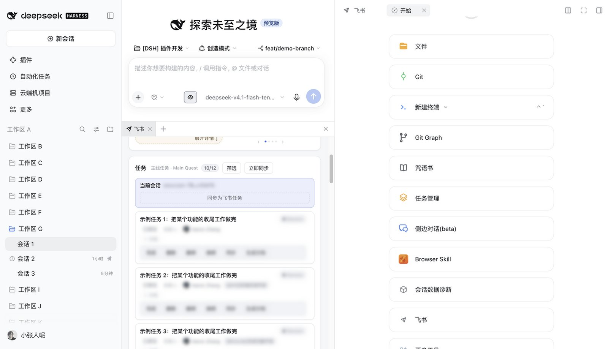

### 局部界面（原文标注已模糊） · 今日洞察

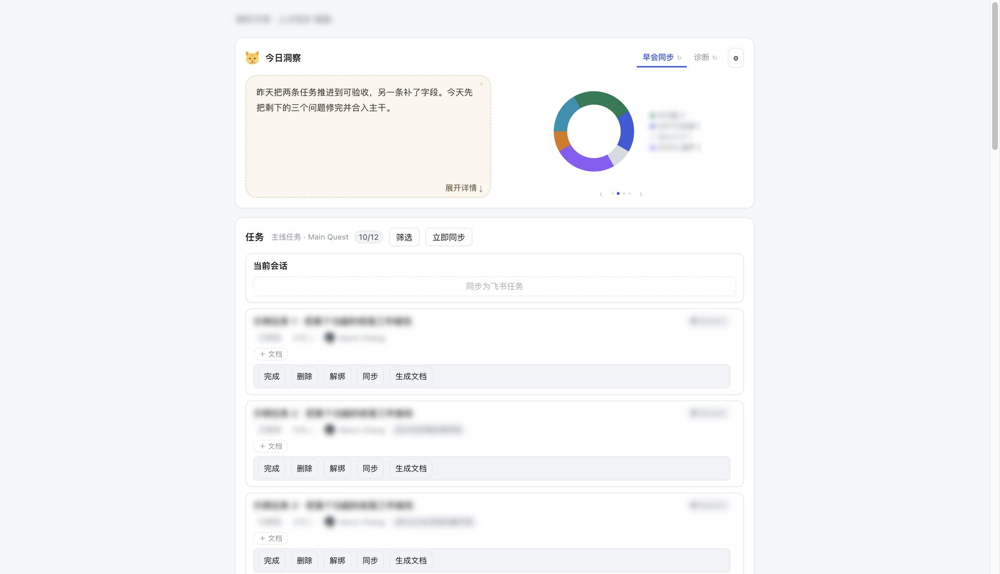

### 布局示例（原文标注已脱敏） · 面板在哪儿

### 布局示例（原文标注已脱敏） · 今日洞察

### 布局示例（原文标注已脱敏） · 任务列表

### 布局示例（原文标注已脱敏） · 任务卡

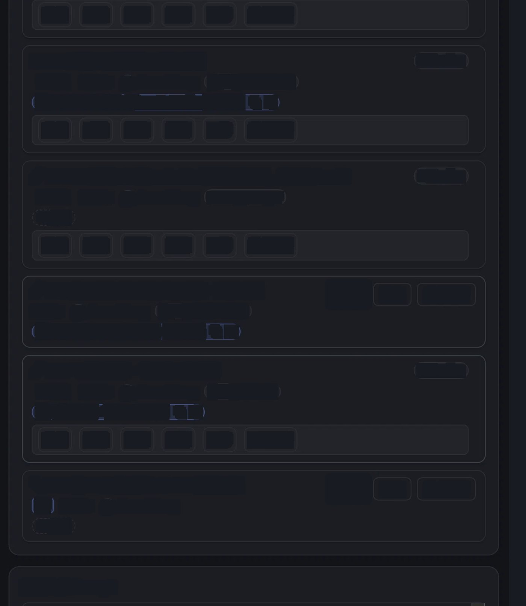

### 布局示例（原文标注已脱敏） · 任务看板

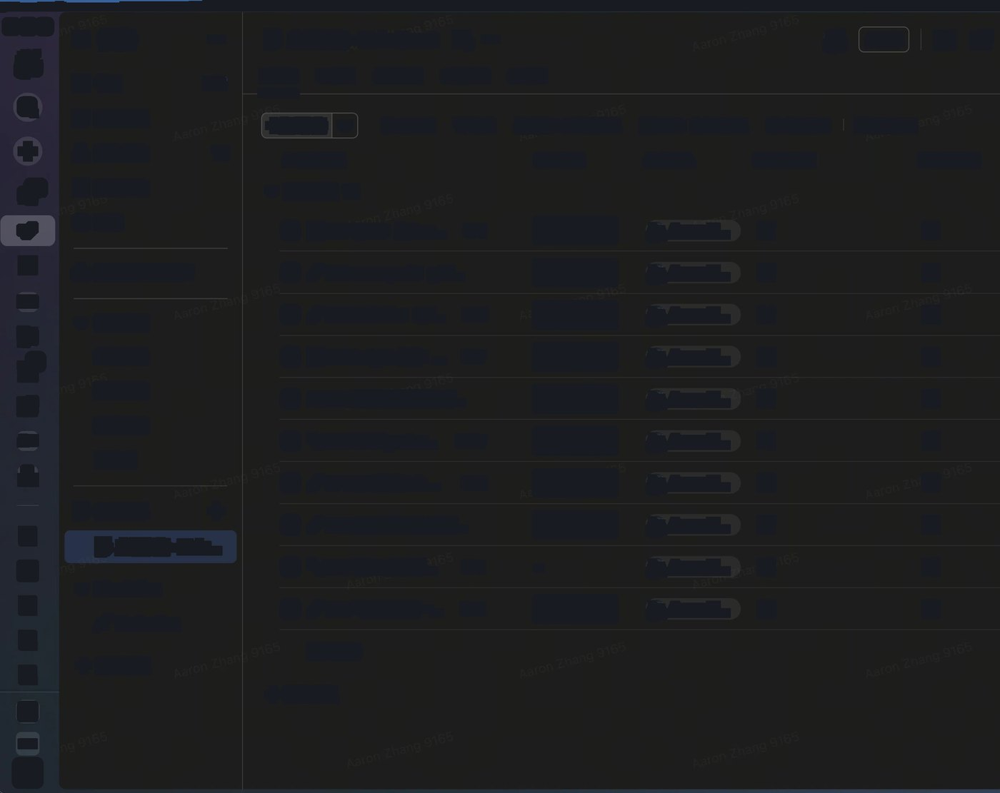

原文有 9 处图片实际为同一张「无法导入该图片」错误提示，未作为操作配图保留。开发记录引用的本地截图未嵌入飞书原文，也未在当前工作区找到。

## 来源

本文由 8 篇使用说明及 1 篇开发记录合并，整理于 2026-11-03；原文档保留不变。

- [DSH 飞书插件 · 使用说明](https://momenta.feishu.cn/docx/Dam7dBYhColMBUxbPNZc4sYKnOb)
- [DSH 飞书插件 · 使用说明](https://momenta.feishu.cn/docx/IQJsdiFidotJYTx6bDicLm3AnAd)
- [DSH 飞书插件 · 使用说明](https://momenta.feishu.cn/docx/Dr1pdH2rboJtEXxiNgLcYNWZnud)
- [DSH 飞书插件 · 使用说明](https://momenta.feishu.cn/docx/FHuDdz1ZnoCYvFxmwGCcurCqnEQ)
- [DSH 飞书插件 · 使用说明](https://momenta.feishu.cn/docx/GjEVdvDPQoxEALxUsEcc9zLLnwd)
- [DSH 飞书插件 · 使用说明（v2 整机截图）](https://momenta.feishu.cn/docx/J8OGdCFzWoa8CnxHFNiccLCVnGe)
- [DSH 飞书插件 · 使用说明（v3 浅色整机）](https://momenta.feishu.cn/docx/SIWdd354uo0bUTxEMSYcU8UPndd)
- [DSH 飞书插件 · 使用说明（已脱敏截图）](https://momenta.feishu.cn/docx/ZfK6d7BgKorJ72xNiYBcZUyznJb)
- [飞书插件第一个版本开发完善](https://momenta.feishu.cn/docx/XKe1dZ6Cbo2x4mxbSshc889xnMf)
