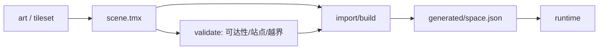

# 场景资源与碰撞：正规游戏开发的组织方式

> 这份文档回答一个问题：**地图、碰撞、站点、导航这些数据，正规项目是怎么产、怎么存、怎么进运行时的？**
> 结论先放前面：**编辑器是唯一可编辑源，运行时只读构建产物；碰撞是"画"出来的，不是从美术反推出来的。**

## 一、四层，不要混在一起

| 层 | 内容 | 谁改 | 运行时读吗 |
|---|---|---|---|
| **源资产** | PSD/Aseprite/图集原图、Tiled/LDtk/Godot 工程 | 美术 / 关卡设计 | 否 |
| **场景工程** | `.tmx` / `.ldtk` / `.tscn`：图层、对象层、prefab 实例、碰撞形状 | 关卡设计 | 否 |
| **构建产物** | 导出的 JSON/二进制：碰撞矩形、导航网格、站点、出生点 | 构建脚本 | **是（唯一）** |
| **内容配置** | 任务、对话、角色、站点能力 | 策划 / 程序 | 是（按 id 引用场景） |

关键：**源资产和场景工程不进运行时**。运行时不解析 TMX、不读 alpha、不猜"这格能不能走"。
所有几何在构建时已经确定，运行时只消费结果。

## 二、正规项目的资源分层

### 1. 地图 = tilemap + object layers

- **tile layer**：地板、墙、家具。每张 tile 的碰撞形状挂在 **tileset** 上（Tiled 的 tile collision、Godot 的 physics polygon）。
- **object layer**：碰撞体、出生点、触发器、站点、导航阻挡。矩形/多边形直接画。
- **prefab**：一张桌子跨 2×2 格时，不是"四张 tile 各挡各的"，而是一个 prefab（桌 + 椅子 + 碰撞 + 吸附点）整体放置。
- **排序层**：地板固定底层；墙/家具/角色按 **脚底 Y** 排序；"永远在角色上方"的贴图（吊灯、顶灯）单独一层。

### 2. 碰撞与导航分开

- **physics/collision**：玩家实际撞到什么。按美术轮廓或设计意图画，通常比格子细。
- **navigation**：A* 用的网格/导航网格。由碰撞**烘焙**出来（或手刷），允许比碰撞保守。
- 两者是**不同产物**：碰撞错了玩家会穿模；导航错了 NPC 会绕路。不要拿其中一个代替另一个。

### 3. 坐标与单位只换算一次

- 约定世界单位（1 unit = ? px）、y 轴方向、原点、角色 pivot（脚底）。
- 地图像素 → 世界单位的换算只发生在**导入器**里；运行时、编辑器、审计都用世界单位。
- 这条不守，就会出现"差 16 倍""偏半格""绿框和墙对不上"——本项目的空气墙问题一半来自这里。

### 4. 构建管线 + 校验



- 导入器是**唯一**把编辑器格式变成运行时格式的地方；
- 产物提交进仓库（或构建时生成），**不许手改**；
- CI 校验：站点是否在可走格、碰撞是否越界、关键路径是否可达、碰撞与视觉是否明显偏离。

### 5. 资源目录（推荐）

```
assets/raw/        # 源图、aseprite、psd
assets/atlas/      # 打包后的图集
maps/              # .tmx / .ldtk（唯一可编辑源）
generated/         # 导入产物，勿手改
content/           # 任务/对话/站点能力，按 id 引用 maps
tools/             # 导入器、校验器
```

## 三、对照本项目：现在 vs 正规

| 项 | 现在 | 正规 |
|---|---|---|
| 地图源 | `office.png` 烘好的整图 + 反推 JSON | `.tmx`/原工程，tile + object layers |
| 碰撞 | 从 alpha、nav、占位格**推导**，再人工修 | 在编辑器里**画**，随场景一起版本化 |
| 导航 | 从内容 `walkable` 数组来 | 从碰撞烘焙，独立产物 |
| 运行时 | 自己 fetch colliders、补格、读覆盖文件 | 只读 `generated/space.json` |
| 修改流程 | 改代码/改 JSON/再构建 | 打开编辑器改，保存，导入，刷新 |
| 审计 | 事后 `airWallAudit` 猜 | 导入时校验 + 可视化 diff |

**为什么反复修不好**：现在的碰撞是"从结果反推原因"——美术烘成一张图，再从 alpha 猜哪里是墙。
正规流程里碰撞和美术是**同时产出**的（tileset collision / prefab），不存在"猜"这一步。

## 四、如果拿不到原工程，最小改造

1. **冻结现状**：把当前 209 个矩形作为 baseline 写进 `maps/office.tmx` 的 `colliders` 对象层（已完成：`tools/office-colliders.tmx`）。
2. **补对象层**：`stations`（站点/吸附点）、`nav-blockers`（可选），都放在同一个 TMX 里。
3. **导入器**：`scripts/import-tiled-colliders.mjs` 扩展成 `import-scene.mjs`，输出
   `generated/office.space.json`（rects + stations + nav 输入）。
4. **运行时只读产物**：删掉 alpha 推导、art 占位、gap fill、override 优先级；
   `SceneSpace` 只从 `generated/*.json` 构建。
5. **校验**：`scripts/validate-scene.mjs` 检查站点可走、矩形越界、关键点可达。
6. **换图流程**：美术出新图 → 更新 TMX 底图 → 调碰撞 → 导入 → 刷新；代码零改动。

## 六、本项目当前落地（R234）

- `tools/office-scene.tmx`：**所有元素都是对象**（249 个），每个带 `id/kind/texture/sx,sy,sw,sh/sort/depthBias`；
- `scripts/import-scene-objects.mjs` → `office-objects-override.json`：运行时按 id 改 `sort`/`depthBias`/位置；
- 碰撞仍是独立的 `colliders` 对象层（`office-colliders.tmx` → `office-colliders-override.json`）；
- 渲染排序统一为：`floor` 固定最底、`sortable` 按底边 Y、`above` 固定最上。

下一步（可选）：把碰撞体也挂到同一个对象 id 上（tile 的 collision 或 prefab），
这样移动/改层级时碰撞跟着走，才完全符合第一节的"一个元素一份数据"。

## 五、一句话原则

> **能画就不要猜；能在编辑器里改就不要在运行时补；源和产物分开；碰撞和导航分开。**
