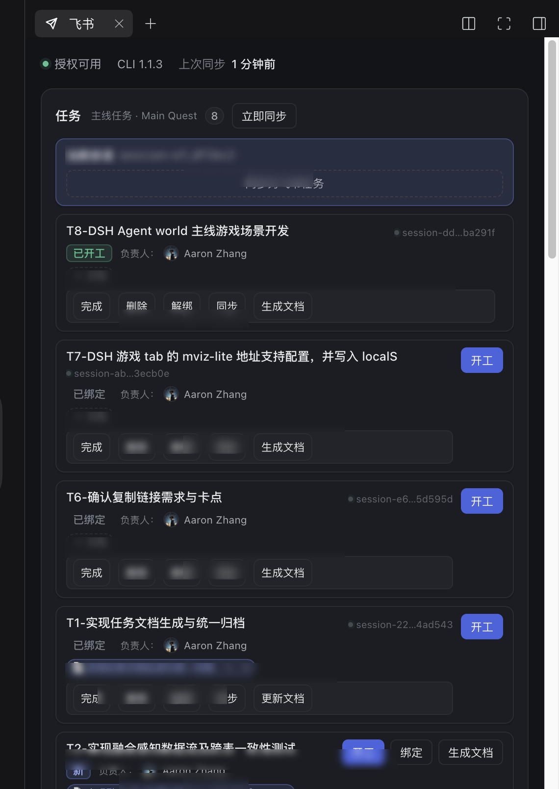
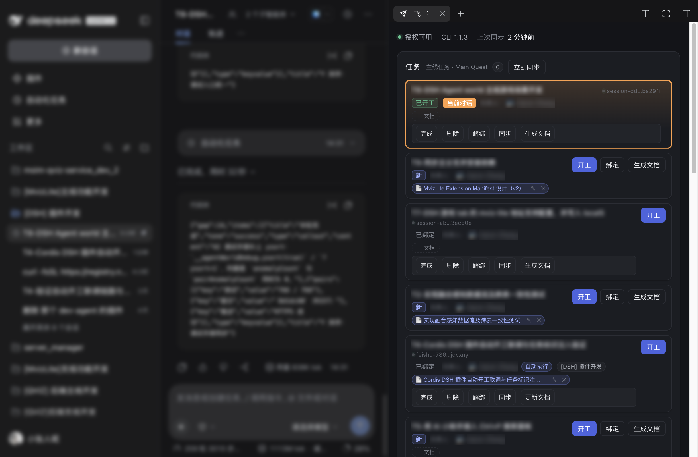
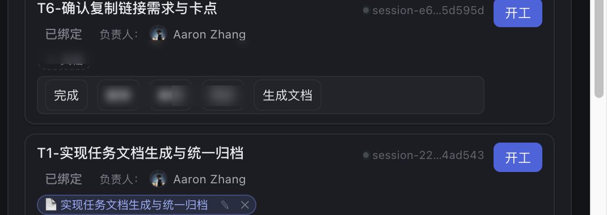
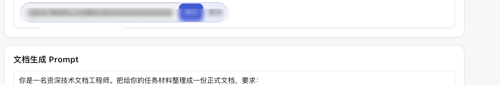
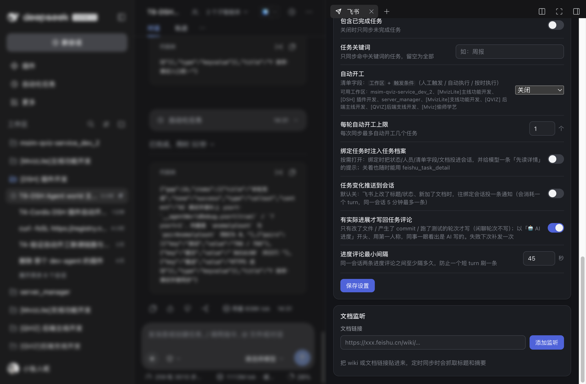
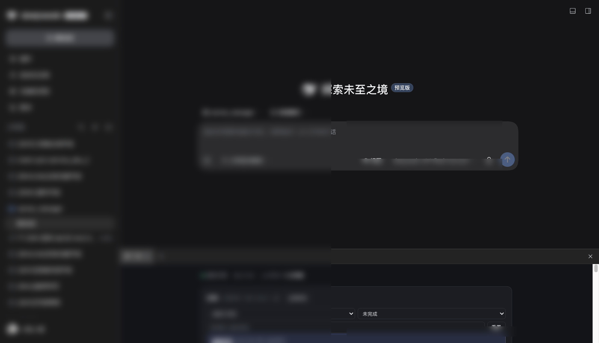

# dsh-feishu

把飞书接进 DeepSeek Harness：**配好授权，定时把任务和文档同步到本地；任务可以一键开成 DSH 会话直接开工。**

## 它做什么

| 能力 | 说明 |
| --- | --- |
| 授权 | 面板里点「开始授权」，走 `feishu-sync-cli` 的个人 OAuth；令牌由 CLI 自己保管和刷新，插件不碰密钥 |
| 任务同步 | 按间隔（默认 30 分钟）拉 `task list`，落到本地快照；支持只拉未完成、关键词过滤、截止日窗口 |
| 文档同步 | 监听若干 wiki / 文档链接，抓标题、最后修改时间和正文摘要 |
| 手动开工 | 在侧边栏点「开工」= **在当前对话里开工**：任务绑到这条会话并把描述投递进来；不在会话里（独立窗口）时才新建 |
| 自动开工 | 三档：关 / 只开标注过的 / 所有新任务（默认关，每轮最多 N 条）。标注方式见下 |
| 任务 ↔ 会话绑定 | 开工时自动绑定；面板可「打开会话 / 复制 ID / 解绑」，也能把当前会话认领给某条任务（`feishu_task_session`） |
| 飞书式卡片 | 任务卡显示负责人/关注人头像与姓名、清单名、清单自定义字段（状态/优先级…）以及工作区解析结果 |
| 任务详情 | `feishu_task_detail` 一次拿全：状态/负责人/关注人/创建人/时间/清单字段/文档/**评论/子任务/附件**（后三样走补充通道，120s 缓存，缺 scope 时降级显示原因） |
| 进展回写 | 每个 turn 结束，把这一轮结论写进绑定任务的飞书评论（去代码块、≤600 字、同会话最小间隔可调、失败下次补发一次） |
| 会话感知 | 开工时投「任务档案」（全字段）；可选「绑定即注入」与「变化推送」两个开关，默认都关 |
| 任务文档 | 卡片里直接「＋ 文档」贴链接绑定（绑过就不再显示）、`✎` 改链接、`✕` 解绑；绑定/解绑/改链接都**立刻**同步飞书「文档」字段，任务改名时它生成的 docx 标题也跟着改 |
| 页面截图 | `docs/shots/` 下六张**整窗截图**（总览、任务卡文档行、卡片内绑定、改文档链接、设置、任务过滤），会话列表/对话区/任务标题/人员姓名均已模糊 |
| 模型工具 | `feishu_tasks`（读任务）、`feishu_sync`（立即同步）、`feishu_doc_read`（读文档）、`feishu_task_session`（任务↔会话）、`feishu_task_report`（把会话结论回写到绑定任务）、`feishu_task_comment`（写评论） |
| 面板 | 右侧栏「飞书」页签：授权状态、同步设置、任务列表（开工 / 略过）、文档监听 |

## 依赖

- 本机装好并已授权 `feishu-sync-cli`（`python3 -m pip install feishu-sync`，或 uv tool）。
  插件会在 `~/.local/bin`、`/opt/homebrew/bin`、`/usr/local/bin` 里找；找不到就在面板里提示，
  也可以在设置里把 `cliPath` 写死成可执行文件的绝对路径。
- 未授权时插件照常加载，只是面板显示「需要授权」——不会拖垮 profile 启动。

## 在飞书任务里配置「工作区 + 自动开工」

**首选：清单自定义字段。** 在任务所在清单上加两个字段：

| 字段 | 类型 | 值 |
| --- | --- | --- |
| 工作区 | 文本 | DSH 里已登记的工作区标题，或绝对路径 |
| 触发条件 | 单选 | 人工触发 / 自动执行 / 按时执行 |
| 开始时间 | 任务原生「开始时间」 | 按时执行的触发时刻 |
| 结束时间 | 任务原生「截止时间」 | 过点不再自动开工 |

字段名可以在面板设置之外通过 `settings.taskFields` 改（默认就是「工作区」「自动开工」）。
读/建这些字段需要 `task:custom_field:read` / `task:custom_field:write` 两个 scope；
插件用 `feishu_api.py` 复用 feishu-sync-cli 的 token 调对应接口，不另存一份凭据。

旧任务仍可在描述里写（字段不存在时才生效）：

```
工作区: dsh-plugins
自动开工: 是
```

- 工作区名匹配的是 DSH 里**已登记**的工作区标题（也接受绝对路径）。拼错不会乱开工，而是把错误显示在任务上。
- 三档开关：`关闭` / `只开标注过的` / `所有新任务`。`自动开工: 否` 在「所有新任务」下也会被跳过。
- 也可以只在标题里写 `[ws:dsh-plugins]`；什么都不写时用默认工作目录。
  （原设计里「任务清单名当工作区名」的兜底保留了代码，但 `task list --json` 只回清单 guid 不回名字，
  实际不会生效——等 CLI 带回名字再启用。）
- 每轮最多开 `maxAutoStartPerRun` 条（默认 1），避免一次同步把 token 全烧掉。
- 自动开工始终**新建**会话（没有「当前会话」这个概念）；手动开工才复用当前对话。
- 「按时执行」由插件每 30 秒巡检一次到点任务，到点后立刻跑一轮同步——不需要给未来任务预建空会话，
  也不依赖 cron。实测开始时间 15:41:26，15:41:49 触发（≈23s 误差）。

### 工作区字段会自动补写

任务卡上算出来的工作区，不只是给你看——同步时还会**写回任务的「工作区」自定义字段**：

- 只填空值（你自己填过的不会被覆盖），一轮最多补 5 条，避免拖慢同步；
- 来源优先级：任务自己声明的 → 绑定会话所属的工作区（查登记表的 `sessionIds`，宿主重启过也能查；查不到再退回
  `inspect` 拿 cwd 反查）；
- 开工 / 绑定之后立刻补一次，不用等下一轮同步。
- **选项自动补齐**：同步时把「登记表里的工作区 ∪ 任务上出现过的名字」和字段现有选项比一次，
  缺的补上（只在缺的时候发请求，稳态下就是一次内存比较）。所以你在 DSH 里新建一个工作区、
  把会话绑给任务，飞书那边的下拉里就会自动出现这个选项，不用先手工加。
- **字段类型支持文本 / 单选 / 多选**：单选写的是选项 guid（不是文本）；选项里没这个名字时，
  桥接会**带着现有选项的 guid** 追加一个——不传 guid 的整表重写会重建所有选项，
  所有任务上的旧值就全失效了（踩过）。

所以默认清单里那些「跑了半天但工作区空着」的任务，会慢慢补齐；本来就没有会话、也没声明工作区的任务保持空。

## 会话怎么感知任务

分四层，按「要不要花 token」切开，默认只开前两层：

| 层 | 触发 | 给会话什么 | 开关 |
| --- | --- | --- | --- |
| L1 开工档案 | 开工 / 自动开工 | 结构化「任务档案」：状态、负责人/关注人/创建人、开始截止、清单自定义字段、文档、任务链接 | 始终开 |
| L2 按需详情 | 模型主动调 `feishu_task_detail` | 上面全部 + **评论 / 子任务 / 附件** + 任务说明全文（120s 缓存） | 始终可用 |
| L3 绑定注入 | 绑定任务到会话时 | 往会话投一份任务档案 + 「要更多就用 feishu_task_detail」 | `contextInjection`，默认关 |
| L4 变化推送 | 同步发现标题/状态/新增文档变化 | 一行通知（同一会话 5 分钟最多一条，一轮同步最多一条） | `pushChanges`，默认关 |

几点取舍：

- **不在每轮注入全量**：任务档案走 L1/L3 一次性投递，之后要最新就调 L2；常驻的只有 L3 打开时那段几行的提示。
- **评论/子任务/附件是懒加载的**：这三样要额外打三次飞书接口（`/task/v2/comments`、`/task/v2/tasks/{guid}/subtasks`、`/task/v2/attachments`，都是资源型接口，路径写错会 404），所以只在调 `feishu_task_detail` 时拉，带 120s 缓存。
- **缺权限不炸**：没授 `task:comment:read` 这类 scope 时，详情里对应段落显示「（读取失败：…）」，其它字段照常。
- **评论人姓名**：评论的 creator 不一定是任务成员，第一次遇到会补查一次用户信息，查不到就退回显示 `ou_xxx`。

## 版本显示

插件版本并进状态条里 CLI 那个 chip：`v0.6.1 · CLI 0.3.1`——一行同时看到「插件哪一版 + CLI 什么状态」，
不额外占一行。版本来自宿主 `/api/state` 的 `version`（`package.json` 现读，不是写死的），
侧边栏同时开好几个插件时也能分清谁是谁。

## 任务过滤

列表上方有一排过滤条，条件记在 `localStorage`，刷新还留着：

| 控件 | 作用 |
| --- | --- |
| 工作区下拉 | 只留某个工作区的任务（选项从当前快照里出现过的值生成，不是写死的） |
| 状态 | 未完成（默认）/ 全部状态 / 已完成 |
| 关键词 | 按标题 + 描述做不区分大小写的包含匹配 |
| 重置 | 三个条件一起清空 |

计数会变成 `筛出数/总数`（例如 `2/7`），一眼知道筛掉了多少。工作区过滤对「没写工作区」的任务是排除的——
要连它们一起看就选「全部工作区」。

## 当前对话的卡片

面板会拿到宿主推来的「当前会话 id」（`postMessage: dsh-feishu:context`），把它绑定的那张任务卡单独标出来：

- 描边换成**橙色**（`--p-select`，浅色 `#ea6a12` / 深色 `#ff9f45`），带 2s 呼吸动画（`task-current-pulse`）
- **底色也换**：橙色自上而下淡出（`linear-gradient(var(--p-select-weak), transparent 72%)`）压在卡片底色上，
  和一堆白卡拉开距离，正文对比度不受影响
- 「当前对话」徽标是橙底白字，不跟强调蓝混在一起
- **自动置顶**：这条任务卡永远排在列表第一位（只换顺序，不改快照；
  其余任务之间的相对顺序保持不变），翻面板时第一眼就是「我现在在干的这条」
- 标题行右侧多一个「当前对话」徽标
- `prefers-reduced-motion` 下保留描边、关掉动画

没绑定任务时不会高亮——那种情况下第一张卡是「当前会话 → 同步为飞书任务」的入口。

## 进展自动写回评论

绑定了任务的会话，**有实际进展的 turn 结束**时，把这一轮干了什么写进飞书任务评论。

- **触发点**：宿主 `session/event` 的 `turn/end`（一轮 = 一个 turn，模型吐多段也只写一条）。
- **只在有硬证据时写**：这一轮**改了文件**（`write`/`edit` 类工具带 `file_path`）、**产生了 commit**
  （命令里有 `git commit`，或正文提到「提交/commit」并带短码）、**跑了测试**（命令里有 test/pytest/jest/vitest）。
  只是聊了两句的轮次不写——评论列表才不会变成噪音。
- **格式**：`🤖 AI 进度 · 21:20` 开头，正文用第一人称（「我改了 2 个文件：…」「我提交了 commit：5d2d362」
  「我跑了测试：node test/meta.mjs」），末尾附一句本轮结论（≤240 字），整体 ≤700 字。
- **频率**：同一会话两条之间至少隔 `autoCommentMinSeconds`（默认 45 秒，面板可调 10–3600）。
- **失败**：写失败只记 warn，并挂进内存队列，下一次 turn 结束补发一次，不做无限重试。
- **开关**：`autoComment`（默认开）。

> 一句话取舍：这里刻意不调模型做二次摘要——每个 turn 多花一次模型调用既慢又贵；
> 直接裁切助手文本已经能让同事看懂「这一轮做了什么」。

## 从会话回写飞书

任务面板里的**第一张卡**是「当前会话」卡，只在**这条会话还没绑定任何飞书任务**时出现：

```
会话未绑定任务  →  显示「当前会话」卡 + 「同步为飞书任务」按钮
点这个按钮      →  宿主读会话记录里最后一条助手回复，清洗掉代码围栏
                   派生标题（首行，≤30 字）+ 描述（前 2000 字，坏链已降级为文字），用 CLI 建任务
创建成功        →  自动加进你那个清单（add_tasklist）并绑定会话；这张卡消失，新任务以普通任务卡出现
先点「开工」    →  会话被绑定；这张卡同样消失
```

也就是说：这张卡是「还没有任务的会话」的入口，一旦会话有了归属任务，它就退场，不会和普通任务卡重复。

另外两条回写路径仍然在：

- **模型**：让 agent「把结论同步到飞书任务」，调 `feishu_task_report`（默认取当前会话绑定的任务）。
- **快速完成**：任务卡会话行的 `✓`，只把任务置完成、不写评论。

## 文档

任务上的文档用清单自定义字段承载（字段名默认「文档」，可在 `settings.taskFields.doc` 改），
卡片里是一行可操作的 chip，不只是一串链接：

| 动作 | 在哪 | 落到哪儿 |
| --- | --- | --- |
| 绑定 | 还没绑文档时卡片文档行有「＋ 文档」→ 贴链接 → 回车/绑定 | 本地记一条 `手动` 文档 + **立刻**把链接写回飞书「文档」字段（一行一个） |
| 解绑 | chip 右侧的 `✕` | 从本地移除 + 同步重写飞书字段；飞书里的文档本身不删 |
| 改链接 | chip 右侧的 `✎` | 换成另一篇文档：标题按新链接重新问一次，并重写飞书「文档」字段 |
| 生成 / 更新 | 卡片上的「生成文档 / 更新文档」 | 在 `DSH 任务文档 / <T<n>-任务名> / <任务名>.docx` 落一篇，链接同样写回「文档」字段 |
| 改名联动 | 双击任务标题改名 | 任务名变了，**它自己生成的那篇文档**的标题也跟着改成新任务名（手动绑定的外部文档不动） |

几条实现上的取舍：

- **一条任务一篇文档**：已经绑了文档就不显示「＋ 文档」，换/删走 chip 上的 `✎` / `✕`，避免卡片上堆一串入口。
- **会话能感知文档**：开工投递的提示词里有「文档：」一段（`{{docs}}` 占位符；
  老的自定义模板没写这个占位符时，文档会追加在提示词末尾，不改你的措辞），
  模型工具 `feishu_tasks` 的输出也带每条任务已绑定的文档链接；要读正文再调 `feishu_doc_read`。
- **绑定即同步**：`bindTaskDoc()` 写完本地马上 `pushDocField()`，不用等人再点一次「同步」；
  面板的 toast 会明确说是「已绑定并写回飞书」还是「已绑定但写回失败：原因」，失败不假装成功。
- **任务改名联动用的接口**：docx 没有「更新标题」的开放接口，Drive 的改名又要 `docx:document:write_only`
  （个人令牌通常没授这个 scope）。所以改的是 docx 的**页面块**（root block，`block_id == document_id`）的
  text——它就是文档标题，权限只要 `docx:document` 写，实测改完 `GET /docx/v1/documents/{id}` 的 title 立即变。
- **字段里只有链接时补标题**：别人的任务字段里可能只有一个 docx 链接。同步时按 URL 去问一次 `info_page`，
  结果进 `state.docTitles` 缓存（问过没拿到就记 `null`，不会每轮重试），每轮最多补 3 篇。
- **识别**：从任务描述里抽 `docx / docs / wiki / sheets / base` 链接，和本地文档一起按 URL 去重展示。
- **渲染限制**：飞书 docx 的文本块不解析 Markdown，表格和 Mermaid 目前是**原样文本**（管道表格 / mermaid 代码）。
  要真正渲染成表格需要用 docx 表格块逐格创建，Mermaid 需要先渲染成图片再插入——这两步还没做。

截图取自 DSH 右侧栏里的「飞书」页签（暗色主题），任务标题与人员已模糊处理：

| | |
| --- | --- |
整窗截图：左侧会话列表与中间对话区已整体模糊，右侧「飞书」页签保留（任务标题/人员另行模糊）。

|  |  |
|  |  |
|  |  |

## 会话跳转

点任务标题后的会话 id（`● feishu-xxx…`）会跳到那条对话：面板 `postMessage` 给宿主，
client 半体调 `uiWorkspace.openSession(sessionId)`，并把结果回传给面板（成功 toast「已切换会话」，
失败 toast 具体原因）。注意 client 半体是宿主启动时打包的，改了之后需要重启宿主才生效。

## 任务名：双击改名 + AI 起名

- 任务卡上的开工按钮就叫「开工」，不跟括号说明；当前会话能不能复用由 tooltip 和结果提示表达。
- 卡片有两个入口：**开工**（会投递任务描述，真正开始干活）和 **绑定**（只把当前会话绑到任务并同步名称，
  不投递、不开工，卡片显示「已绑定」）。已绑定的卡上再点「开工」才会把描述投进那条会话。
- 会话行三个动作都真的落到飞书/D SH 上：**完成**＝飞书任务置 done + 归档会话；**删除**＝归档（删除）这条会话、
  任务状态不变；**解绑**＝只清任务↔会话关系（任务回到未开工）。复制按钮已去掉。
- **双击任务标题**进入就地编辑：`Enter` 或「保存」按钮提交，`Esc` 或失焦放弃（失焦不自动保存：点 AI 按钮会抢焦点，
  实测会用旧值把新标题盖掉）。
- 编辑框右侧有「AI 起名」：调 `POST /api/tasks/suggest-title`，把任务标题 + 描述 + 绑定会话最后一条回复
  交给默认模型，按「正式任务名」的提示词生成（12-20 字、动宾结构、书面语、不带标点/人称），只填进输入框，仍由人确认。
  AI 失败时提示里会带原因，不会假装成功。
  注意推理型模型（如 deepseek-v4.1-flash-tencent）会先把 token 花在 reasoning 上：200 的额度能全被推理吃掉、
  一个文本块都不吐。所以标题调用给了 600/1600 两档预算并在空结果时重试，同时兼容 `text-delta` 与 `block-end` 两种取文本方式。
- **任务名格式**：`<表情> T<n>-<标题>`（表情最前，扫一眼先看类型）。`n` 按任务首次出现的顺序稳定分配（存在 state 里，不随同步变化），
  新建任务、AI 起名、手动改名都会补这个前缀；旧标题里的 `Task-xxxxxx` 短码会被清掉。
- **表情前缀**：AI 起名时按「标题 + 任务材料」挑一个表情放在名字前面，方便在列表里一眼分类型——
  🐛 修复 / 🧪 测试联调 / 📄 文档 / 🎮 游戏场景 / 📊 数据指标 / 🔍 排查 / 🚀 发布 / 🔧 重构 / ✨ 新增功能。
  挑不到就按标题哈希落在一个固定集合里（📌🗂️🧩🛠️📎🎯）：同一个标题永远同一个表情，不会每次刷新都变；
  重复起名会先摘掉旧表情再加，不会叠成一串；手动改名沿用原来的表情（自己打了表情就以你打的为准）。
- **专有名词原样保留**：AI 起名时产品/框架/协议/快捷键/接口名（Ctrl+P、Feishu、DSH、Cordis、MCP…）
  不改写、不意译、不泛化。
- 保存走 `POST /api/tasks/rename`：`feishu-sync-cli task update --summary` 改飞书标题 → 更新本地状态 →
  会话还活着就同步改会话名（任务名 = 会话名）。

## 任务名 = 会话名

- **任务 → 会话**：开工（新建会话，或绑定已有会话）时把会话标题改成任务标题；面板上双击改名 / AI 起名后保存、
  以及建任务时，也都会同步改会话名。改名有两条路：会话活着走 `sessionTitle.rename()`（写 user 来源标题事件、钉住），
  会话已归档走 `sessionController.rename({sessionId,title})`（不需要先把 agent 拉起来）。
- **会话 → 任务**：面板上「同步为飞书任务」时，先用 `llm.stream`（purpose: `session-title`）让当前默认模型起一个
  ≤18 字的任务名，失败才回退到「首行 30 字」；建任务后再把这条会话改名成同一个标题（会话没激活就跳过改名，只建任务）。
- 实测：开工后会话标题事件变成 `{"title":"命名对齐验证3（可删）","source":{"kind":"user"}}`，且后续自动标题不再覆盖。

## 任务与会话的对应关系

每条任务最多绑一条会话，每条会话也只会属于一条任务（`linkTask` 会拒绝重复占用）。绑定信息存在
`state.json` 的 `sessionId / startedAt / linkSource` 里；`sessionAlive` 是快照时现算的，只看本进程里
agent 是否还在跑，不代表会话被删了。面板上的「打开会话」通过 client 半体调宿主 `uiWorkspace.openSession`，
所以它切的是右侧栏外的会话视图，不是新开窗口。

## 数据落在哪

- `~/.dsh/dsh-feishu/settings.json`：面板里保存的设置。
- `~/.dsh/dsh-feishu/state-<端口>.json`：同步快照（任务、文档、授权状态、上次同步时间）。
  按端口分文件是因为同一台机器可能同时跑两个 profile 的宿主，共用一个文件会互相覆盖刚绑好的会话。
  **换端口重启不丢状态**：本端口文件还是空的时，会继承同目录里最新一份带会话绑定的 `state-*.json`
  （DSH 每次重启会换端口，不继承的话表现就是「任务卡片集体掉绑定 + 自动开工又开一条新会话」）。
- 飞书令牌仍然只在 `~/.feishu/`，由 CLI 管理，插件不读不写。

## 手动核对

```bash
npm test              # 客户端半体单测 + 宿主半体冒烟（真实读一次飞书任务）
npm run test:client   # 只跑客户端半体：假 ModuleLoader/React/ctx，验注册口
npm run test:smoke    # 只跑宿主半体：假 ctx 起路由，真跑一次同步
```

- `test/client.mjs` 验的是**注册口**：模块必须通过 `__ModuleLoader__.load` 注册、
  `inject` 里有 `betterSidebar`、`registerTab` 收到 `{id:'feishu', component, icon, single}`，
  以及 `betterSidebar` 缺席时 `apply()` 不抛（抛了会把宿主打成错误页）。
- `test/smoke.mjs` 验宿主：路由挂载、`/api/state` 形状、真实同步、设置写入与未知字段过滤、
  开工（用假 `agents`/`sessionController` 抓建会话参数和投递内容）、工具注册。
- 两个脚本都用 `DSH_HOME=/tmp/dsh-feishu-smoke` 隔离设置文件，不会污染你的配置。

## 已验证 / 未验证

已验证（本机 desktop profile）：

- 宿主半体装进 profile 后 `/dsh-feishu/panel` 返回 200，`/api/state` 里 `auth.ok=true`、`cli 1.1.3`；
- 真实同步拉到 6 条未完成任务，`feishu_*` 四个工具都出现在模型工具表里；
- 面板在真实宿主数据下渲染：无横向溢出、无文字裁切、区块顺序正确；
- 客户端半体热更新后，右侧栏页签占用者从旧实现的 `dsh-feishu` 变为
  `dsh-better-sidebar:feishu`，说明新 module 已加载、`betterSidebar.registerTab` 生效。

未验证：

- 没有在真实页面上点过「开工」——那会在你的默认工作目录里真建一条会话并按模板投递任务，
  属于有副作用且有 token 成本的动作，留给你自己按。逻辑本身由 `test/smoke.mjs` 用假会话服务覆盖。
- 页签在右侧栏里的最终像素（字体、行高）没有截图核对，只有 DOM 度量与面板直开截图。

## 权限与安全

- `feishu_task_comment` 是**写操作**，会真的发到飞书。其余工具只读。
- HTTP 路由挂在宿主 webServer 的 `/dsh-feishu` 前缀下，与其它插件同域；没有额外的鉴权层，靠宿主本身只监听 localhost。
- 自动开工会在你的默认工作目录里建会话并立刻跑一轮，**会消耗 token**；默认关闭。

## 路线图

- 任务完成后回写 `task complete`（现在只写评论）。
- 文档增量对比（现在按 `obj_edit_time` 变化重抓摘要）。
- 任务分组的 tasklist 过滤。

## 许可

MIT
