# dsh-feishu

把飞书任务、文档和 DSH 会话接起来：在右侧栏查看任务，选对工作区，绑定或开工，再把进展、预期与协作结果写回飞书。

本指南按实际面板入口组织。**同步、开工、排期、写评论不是同一种操作**；涉及远端写入、会话运行或模型调用的边界在对应功能下说明。

> 本版面向 `dsh-feishu 0.20.1`。十八张截图均来自实际 DSH 测试 profile 或其真实插件面板，使用明确标注的本地演示数据，不是飞书远端回执。
> 复用已有隔离测试 profile `awteam-preview`，通过工作区临时 overlay 挂载本版飞书；DSH `0.2.1-rc.5`、sidebar `0.28.0`。已登录完整 GUI 并在右侧栏添加「飞书」，验证当前会话上下文使绑定入口可用。旧 Agent Teams 因版本不兼容保持禁用，不授予版本豁免。
> 截图展示操作入口和本地状态，不宣称完成真实飞书授权、写回或通知验证。定时图展示设置与触发指令，评论图展示安全设置，洞察图展示本地摘要；没有为了截图运行模型、开工、提交绑定或写入远端。

## 安装与首次使用

需要可运行的 DSH Web/桌面 profile、右侧栏插件 `dsh-better-sidebar`，以及本机 `feishu-sync-cli`。
开工需要宿主会话服务，定时还需要 DSH 自动化服务；缺少服务时功能会明确报错，不自行替换宿主。

安装 CLI 可使用 `python3 -m pip install feishu-sync`，或放进 uv tool 环境。
插件会尝试从常见可执行目录寻找 CLI；找不到时，在插件设置中指定 `cliPath` 的绝对路径。
补充 API 桥接还需能导入 `feishu_sync` 的 Python 环境，不是任意一个 `python3` 都能替代。

通过 DSH 插件管理安装工作区包 `packages/dsh-feishu`，启用其 bundle，然后打开右侧栏「飞书」。
不要手写 profile 的依赖或运行第二个服务来冒充当前 GUI；Host 更新需重载插件或重启 DSH。
面板出现新控件不代表旧 Host 已加载对应接口；单纯刷新页面不能保证 Host 更新生效。

建议先用独立 DSH_HOME 与演示/专用任务清单，关闭自动开工、进度自动评论和评论协作，再进行授权与验证。
默认自动同步开启、间隔 30 分钟；自动开工关闭，进度自动评论开启，评论协作与任务档案注入/变化推送关闭。
首次打开洞察没有缓存时可能自动调用模型，不能把「打开面板」视为必然零 token。

## 1. 侧边栏总览：先确认当前上下文

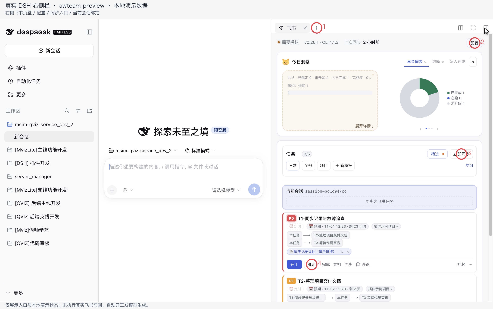

**入口**：DSH 右侧栏 →「飞书」。上方是状态和配置入口，中间是洞察，下方是任务列表。

**怎么用**：先核对插件/CLI 状态、上次同步时间与当前会话；需要配置时点右上角「配置」。
配置分为同步规则、授权、文档生成、文档监听、同步记录；平时可以收起，让任务操作留在主视图。
当前会话绑定的任务会高亮并置顶，任务编号 `T<n>` 稳定保存，不因刷新重新编号。

**为什么**：让任务与正在处理的对话并排，而不是从任务管理器反复复制描述到聊天窗口。

**边界**：任务列表主要来自本地快照，不等于飞书实时全量清单。
会话运行灯、未读点和运行柱来自 DSH 活动事件流；看灯或切页签不等于唤醒会话。
圈注重点：飞书页签、版本/同步状态、配置按钮、当前会话任务。

## 2. 授权：复用 CLI 的个人身份

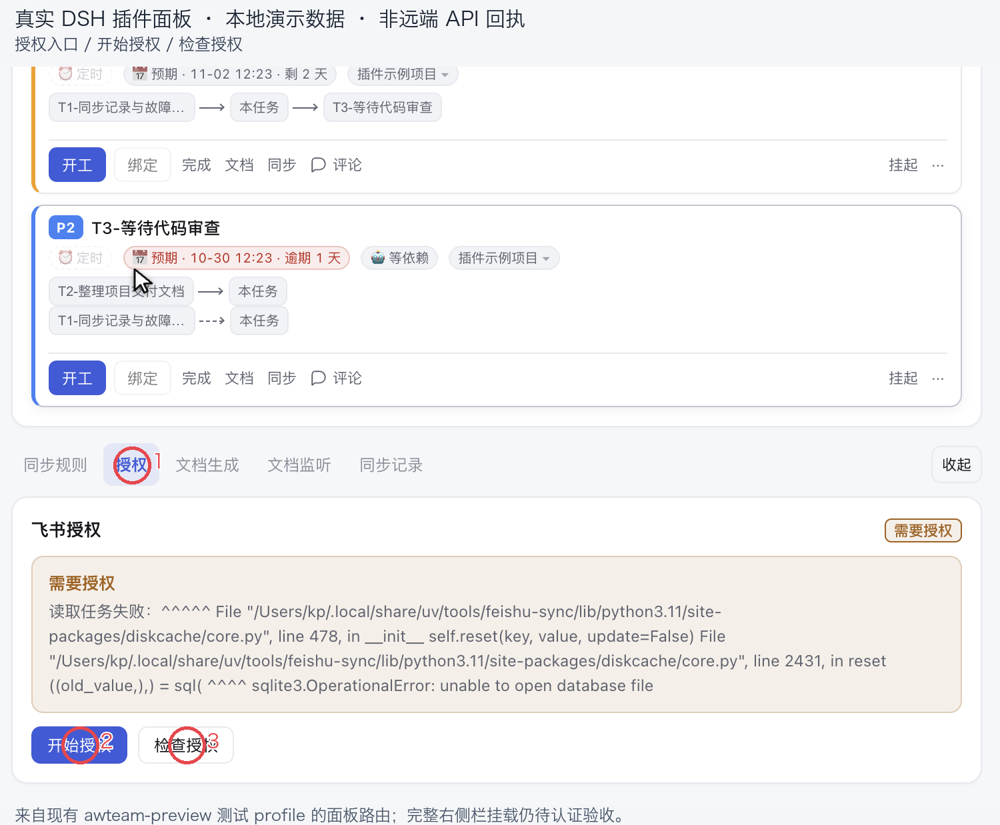

**入口**：「配置」→「授权」→「开始授权」。

**怎么用**：由 CLI 发起个人 OAuth，在授权页面完成登录与权限确认，再回面板核对状态。
授权过期或 refresh token 被吊销时重新授权；CLI 不存在时先处理安装或路径问题。
不要把 token、密码或恢复码粘到对话、README、截图或问题报告中。

**为什么**：沿用 CLI 的授权和刷新机制，不让插件维护第二份会过期的凭据。

**副作用/边界**：授权会联网并改变本机 CLI 的登录状态。
Python 补充 API 通道会调用 `feishu_sync.retoken.get_access_token()` 复用访问令牌；不能说插件完全不读 token。
插件不另存一份凭据；最终能读/写什么仍取决于个人身份、资源权限和已授 scope。
圈注重点：授权状态、CLI 检测、开始授权按钮；授权 URL 的查询参数需要脱敏。

## 3. 同步规则与自动开工

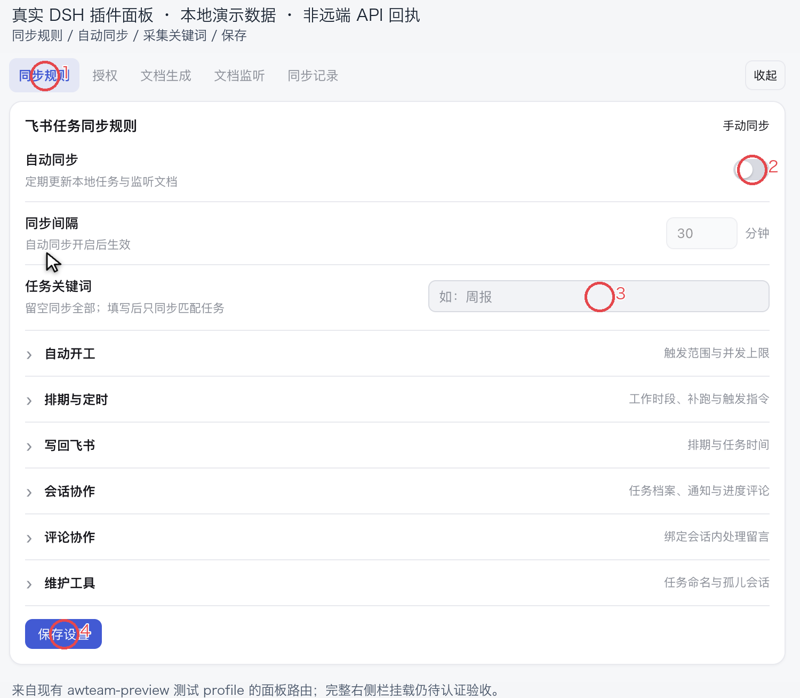

**入口**：「配置」→「同步规则」；手动刷新在任务标题行「立即同步」。

**怎么用**：设置自动同步、间隔和任务关键词，点「保存设置」。
任务是否包含已完成、截止日窗口也有设置项；服务端同步范围与列表筛选是两层不同条件。
展开「自动开工」，选择关闭、只开标注过的或所有新任务，并限制每轮最多开工数，默认 1。
清单可用「工作区」字段声明目的地，「触发条件」单选区分人工触发、自动执行、按时执行。
旧「自动开工」字段/描述标记保留兼容；优先使用当前清单字段，字段名可通过 `taskFields` 配置。

**为什么**：程序按需拉取任务；开工范围单独授权，避免一次同步意外启动一批 agent。

**副作用/边界**：同步会联网、写本地快照，也可能补写工作区/待写字段、尝试逾期 AI 归因或投递评论。
自动开工会新建会话、投递任务并消耗模型 token；人工触发标记在「所有新任务」模式下也会被跳过。
「按时执行」字段不是另一套有效的本地定时器：当前定时必须遵守第 10 节的 DSH 会话绑定要求。
圈注重点：保存设置、同步间隔、开工范围与上限；别把「立即同步」当无副作用刷新。

## 4. 任务与会话绑定：绑定不等于投递

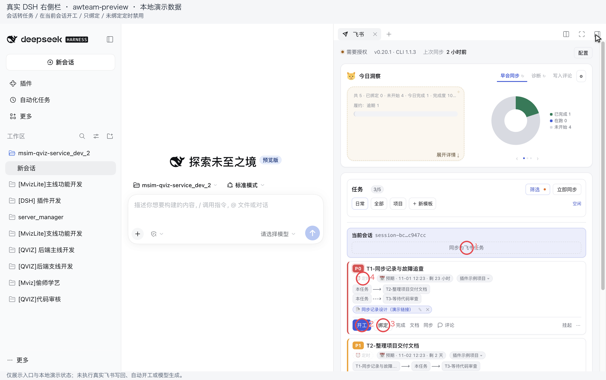

**入口**：未绑定任务卡的「开工」「绑定」，以及未绑定当前会话的「同步为飞书任务」。

**怎么用**：「开工」在当前会话里绑定并投递任务；没有当前会话的独立面板才新建会话。
「绑定」只认领当前会话并同步命名，不投递开工指令；开启绑定注入后仍会额外发送任务档案。
已绑定任务从会话行打开原会话；需要改归属时在「···」选择「换绑当前会话」或「解绑」。
当前会话尚无任务时，「同步为飞书任务」会投递整理指令，让 AI 生成标题/描述并调用 `feishu_task_create`。
已绑定会话创建后续任务需 `followUp=true`，保留原绑定，新任务记录来源；来源不自动变依赖。

**为什么**：让已有对话能被任务追踪，也让任务能进入正确会话，避免反复建立孤儿会话。

**副作用/边界**：一条任务最多绑定一条会话，一条会话只属于一条任务；重复占用会拒绝。
绑定会写本地关系、改会话名，并可能写回开始时间/工作区；开工与会话整理会产生模型轮次。
挂起期间不可换绑或解绑；「打开会话」不等于执行；跳转失败需看回执，不要据此重复新建。
圈注重点：开工与绑定的区别、当前会话入口、已绑定会话行、换绑/解绑菜单。

## 5. 任务卡操作：命名、优先级、完成与删除

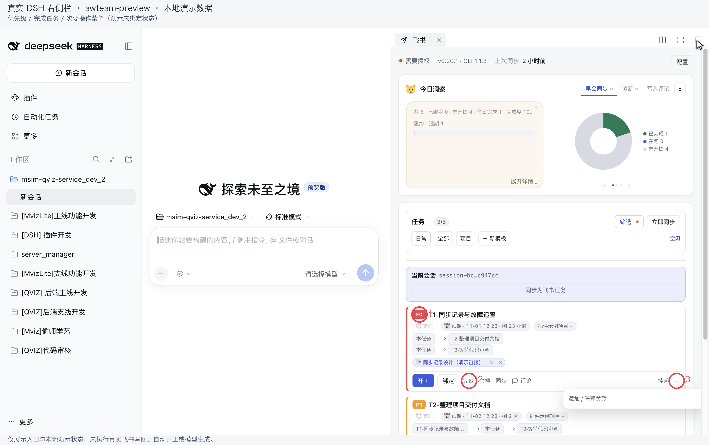

**入口**：任务标题、优先级徽标、卡片底栏与「···」。

**怎么用**：双击标题编辑，Enter/保存提交，Esc 或失焦取消；「AI 起名」生成可用标题后直接写回。
标题统一为「表情 + T<n>-标题」；常规改名会同步改会话名，并联动插件生成文档的标题。
点优先级徽标设 P0/P1/P2/P3 或清除，未设置显示占位；缺少字段时按需建「优先级」单选列。
当前会话任务优先置顶，其余按优先级组织；文档常驻为 Tag，低频操作收入菜单。

**为什么**：标题说明工作内容，优先级说明紧急程度，完成/删除的不同语义避免误伤任务。

**副作用/边界**：「完成」写飞书完成状态并尝试归档绑定会话，不自动补一条评论。
「删除会话」尝试归档并清空绑定，不删除飞书任务、不改变其完成状态；「解绑」只清关系。
AI 起名会调用模型并写远端；归档可能停止活动和自动化，操作后看实际结果与警告。
已完成任务的原绑定会话确实开始新一轮执行时会重开为未完成；仅恢复归档不重开，也不恢复旧定时。
圈注重点：标题编辑、优先级、完成入口与菜单中的删除/解绑语义。

## 6. 工作区：按 ID 绑定，不猜同名项目

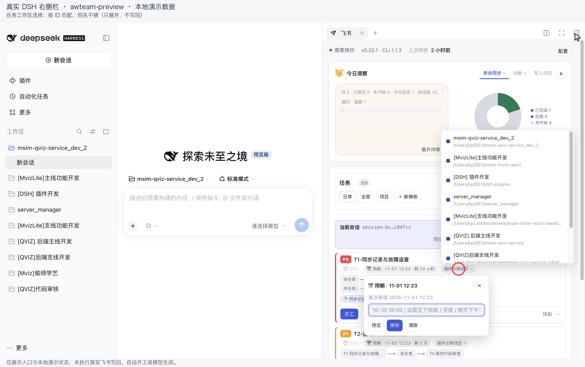

**入口**：任务卡工作区 Tag → 下拉选择；未登记路径可出现「登记为工作区」。

**怎么用**：从 DSH 已登记工作区选择目标，核对标题和路径后换绑。
首次解析可来自清单字段、任务声明或绑定会话所属工作区；此后本地保存 `{id, path, title}`。
工作区改名不会断开 ID 绑定；重名、无法识别或失效项会明确提示，不做包含/路径后缀猜测。

**为什么**：同名目录与重命名常见，按名字猜工作区可能让 agent 在错误代码库开工。

**副作用/边界**：换绑先本地落盘，再后台按任务串行写回飞书，期间可能显示待同步或写回失败。
本地最新选择不应被远端旧字段覆盖；失败留待写状态重试，不意味着远端已更新。
同步可补写空工作区字段，单轮有上限；字段支持文本/单选/多选，选项扩展保留已有 GUID。
圈注重点：工作区标题与路径、失效提示、待同步状态、登记入口。

## 7. 任务关系：依赖与来源分开

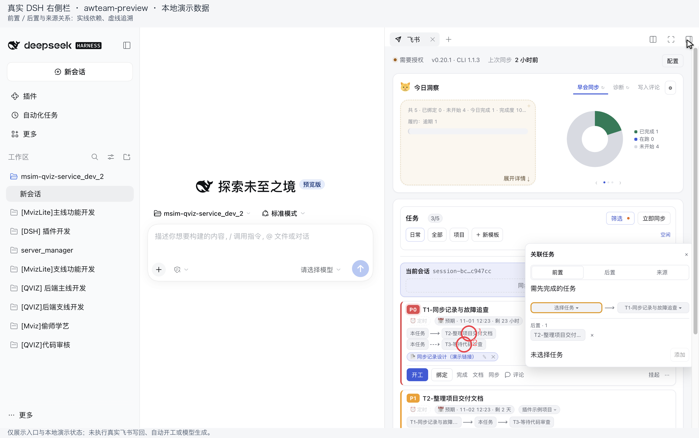

**入口**：关系 Tag、`+N` 局部关系视图，或「···」中的关联管理。

**怎么用**：选择左右任务，添加「前置 → 本任务 → 后置」依赖；派生工作使用来源关系。
管理面板可以搜索候选、连续添加并按类型移除；没有关系的卡片不常驻展示空表单。
工具 `feishu_task_relations` 的 `get` 查看，`suggest` 调 AI 建议但不保存，`set` 才写入。
`merge` 默认追加；`replace` 只替换显式传入类别，空数组清空该类；拒绝自环、环路与不存在的 GUID。

**为什么**：先后顺序会阻塞开工，而来源只说明「从哪条任务派生」，两者不能混为一谈。

**副作用/边界**：`set` 默认同步飞书 Task v2 原生依赖；失败保留本地待同步，`writeBack=false` 才仅本地。
`fields=true` 另外写前置/后置/来源文本列，是展示投影，不是 Bitable 关联记录字段，也不反向驱动依赖。
自动开工前检查前置完成，未知前置保守阻塞；人工开工不强制阻止，已有 DSH 定时投递不受此门控。
创建任务的 `autoRelate=true` 会调 AI 推断并保存，默认关闭；同主题不等于有依赖。
圈注重点：实线依赖、虚线来源、候选搜索、添加与移除按钮。

## 8. 筛选：条件组统一表达

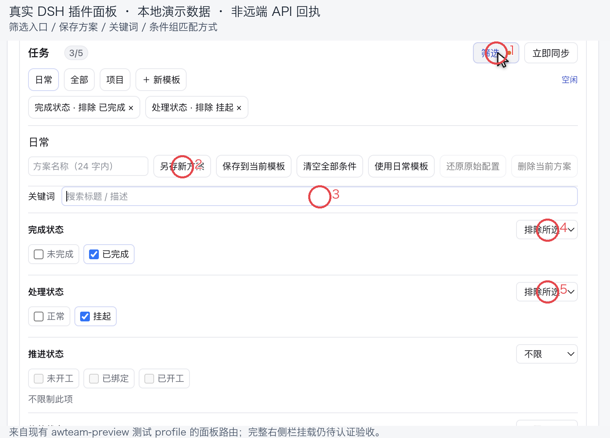

**入口**：任务标题行「筛选」，展开条件组与关键词。

**怎么用**：完成状态、处理状态、推进阶段、依赖状态、优先级、工作区分别选择不限/只看所选/排除所选。
每组可多选，同组任一命中、跨组全部满足，再与关键词组合。
例如只看 P0/P1、排除挂起、只看已绑定；依赖数据缺失标「未知」，不冒充就绪。
摘要可逐组移除；「清空全部条件」始终解除限制，收起面板只隐藏编辑器，不撤销条件。

**为什么**：用同一种语义组合状态，不再叠加相互冲突的完成/挂起开关。

**副作用/边界**：只筛本地快照，不联网删任务；空结果不代表飞书没有任务。
只看模式未选值匹配零条，排除模式未选值不排除；已选但暂不在快照的工作区不会静默丢掉。
规则保存在当前浏览器；重开默认收起，仍沿用生效条件。
圈注重点：条件模式、多选值、关键词、摘要与结果计数。

## 9. 筛选模板：日常、全部、项目与自定义

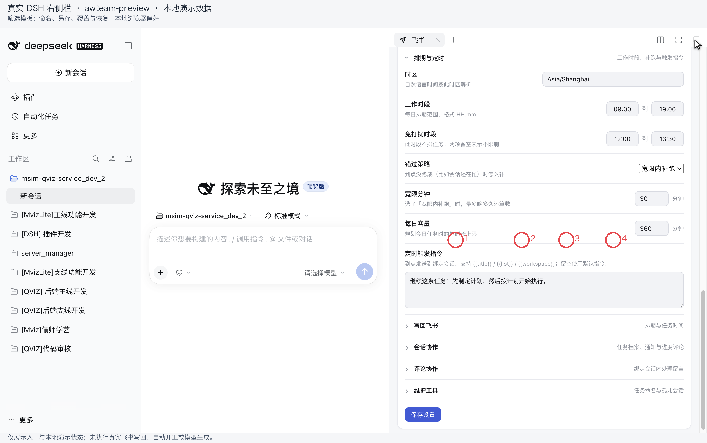

**入口**：筛选模板行，「＋ 新模板」与模板管理。

**怎么用**：「日常」原始配置排除完成/挂起；「全部」原始配置不限；「项目」跟随当前会话工作区。
调整条件后命名保存，可更新自定义模板或覆盖内置模板；内置模板可单独还原。
切换模板替换整套规则并收起详情；想看「仅挂起」时自己配置保存，没有单独内置开关。

**为什么**：重复使用的视角只点一次，不必每次重选所有条件。

**副作用/边界**：模板只存当前浏览器，不同步飞书；存储失败会提示。
项目视图按 ID/路径精确匹配，旧名称须在登记表唯一命中；没有会话上下文时提示，不退回全部。
删除自定义模板不修改当前规则；覆盖「全部」不改变「清空全部条件」语义。
圈注重点：模板行、新模板、覆盖/还原与项目上下文提示。

## 10. 定时与今日排期：DSH 是唯一权威

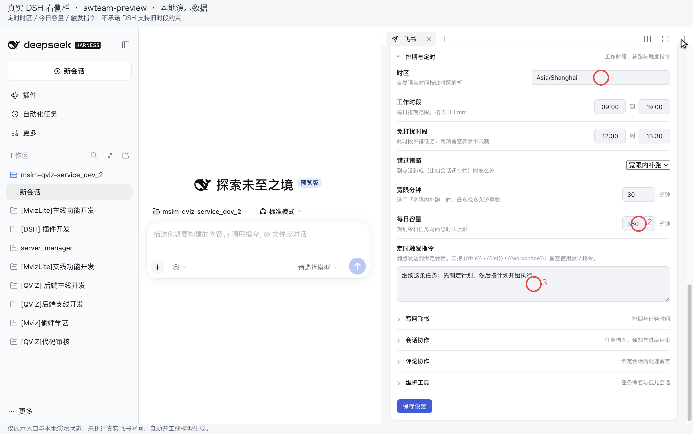

**入口**：已绑定任务卡「定时」→ 输入时间 → 预览 → 保存；对话工具 `feishu_task_schedule` / `feishu_plan_today`。

**怎么用**：自然语言可表达一次性、每隔一小时、每天、工作日、每周、每月或截止前两小时。
默认时区 `Asia/Shanghai`，可在「同步规则」→「排期与定时」修改；保存前核对时区与警告。
定时只写任务绑定会话上的 DSH 自动化记录；已有主记录原地更新，没有则创建。
到点指令来自「定时触发指令」，支持 `{{title}}`、`{{list}}`、`{{workspace}}`。
今日排期先拿候选池，模型给顺序/时长/理由，插件计算时间块，`commit` 才逐项落地。
工作时段、午休与容量用于今日时间块规划，默认 09:00–19:00、12:00–13:30、360 分钟。

**为什么**：时间算术交给程序，投递与历史交给 DSH，避免面板、工具和本地影子定时器各说各话。

**副作用/边界**：必须已绑定会话且 profile 有 DSH 自动化服务；没会话不排期、不退回本地、不到点 spawn。
旧 `state.schedules` 不显示也不触发；工具虽保留 `delivery` 参数，当前有效路径仍只投已有会话。
保存会删除同会话多余自动化，清除会删除该会话全部自动化，包含其他入口建立的记录；先核对用途。
当前 `pause/resume` 不支持，会明确拒绝；要停单条定时请改时间或清除，任务挂起另见下一节。
DSH 不支持 spec extras：免打扰、触发窗口、until、maxRuns 等不会作为投递限制生效，保存会返回警告。
面板的错过策略/宽限设置不是 DSH 投递保证；不要沿用旧版补跑、截止后不触发或插件开工上限的承诺。
相对锚点保存时转绝对时刻，后来改截止不自动移动定时；默认可写回飞书原生开始时间，但不保证通知送达。
圈注重点：会话绑定前提、预览/保存、DSH 来源、下次时间与不支持限制警告。

## 11. 预期与挂起：承诺时间不是开工时间

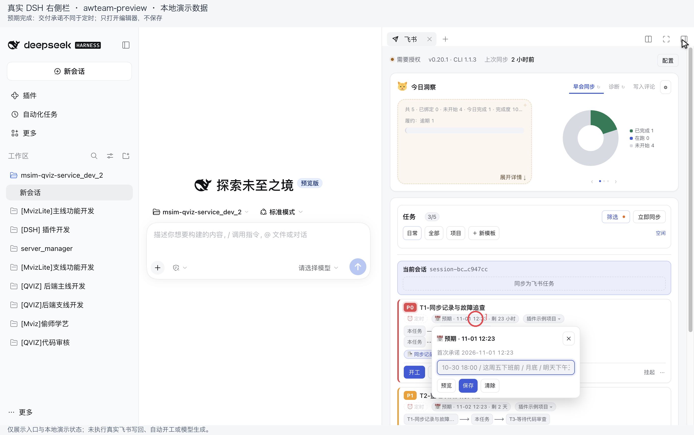

**入口**：任务卡「预期」与「挂起/恢复」；工具 `feishu_task_eta`、`feishu_task_suspend`。

**怎么用**：预期输入「这周五前完成」等人话，先预览再保存；只给日期默认 18:00，可配置。
往后改预期保留延期/重承诺记录并可填原因，往前收紧不计延期；重复周期不适合作为交付预期。
暂时不做时挂起并填写原因，恢复后再人工决定是否开工。

**为什么**：定时回答何时做，预期回答何时交，挂起回答现在是否继续；分开才不会靠改日期掩盖停工。

**副作用/边界**：预期默认写清单「预期完成」文本列，使用 `YYYY-MM-DD HH:mm` 保留分钟精度。
它不是日期列，不能当原生日期筛选；写回失败保留待写标记。开始/结束日期列只在已存在时写，不自动创建。
履约严格口径比较首次承诺，最终口径比较最后承诺；逾期是未完成风险，完成后才结算准时/延期。
挂起归档并停止这条绑定会话，不级联其它任务；跳过自动开工、今日排期及工作区自动补挂。
宿主归档会令活动自动化 inactive；恢复仅重建本次挂起前活动且仍可恢复的规则，新 ID 保留旧历史。
恢复不自动开工、不创建新会话，过期一次性不补发；恢复失败保留挂起与凭据，检查 warnings 后重试。
挂起默认投影飞书「处理状态」单选，`writeBack=false` 才仅本地；飞书改列不会反向归档。
圈注重点：预期与定时分离、改期原因、挂起原因、恢复与待写状态。

## 12. 今日洞察与早会：事实和判断分层

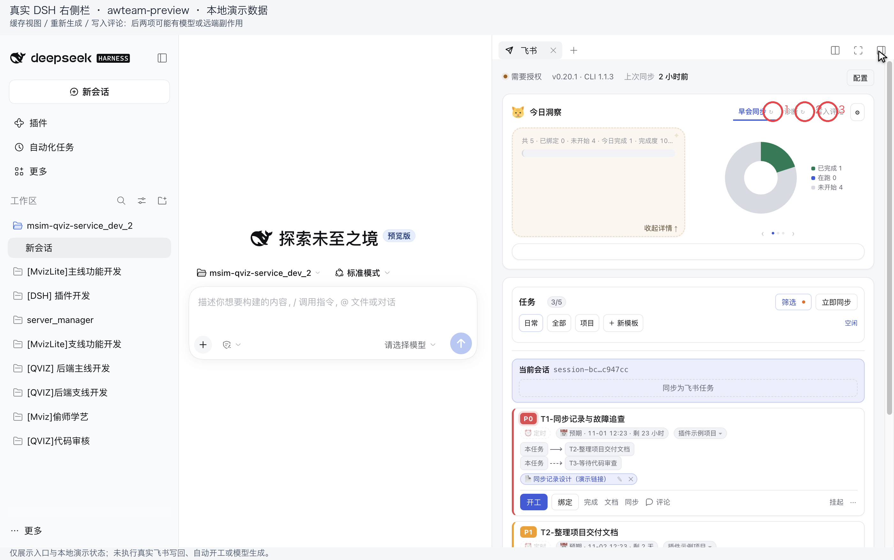

**入口**：任务列表上方洞察卡，选择诊断/早会，展开详情或重新生成；对话可用 `feishu_insight`。

**怎么用**：先看本地完成/开工/WIP/工作区分布，再看 AI 的问题、证据与下一步建议。
早会提供昨天做了什么、今天做什么的口述稿；「写入评论」会把摘要写到选定/当前绑定任务。
模型收到任务摘要、近期会话片段和履约/延期材料，不是自动发送整个代码库或全部对话。
图表数值来自本地数据集，模型选择数据集和解释；卡片统一饼图，不承诺展示任意图形。

**为什么**：同时看推进节奏和履约，避免只凭「任务很多」判断效率；AI 建议要能追溯到材料。

**副作用/边界**：首次进入没有任何缓存结果会自动生成一次并可能消耗模型 token，不是仅点诊断才调用。
已有结果切换页签通常复用；手动重新生成会调用模型。缓存受日期、任务签名、模式/Prompt 等影响，不是永久结果。
没有模型或调用失败保留本地事实，不应冒充 AI 结论；数据范围和统计代理不构成心理判断或未来保证。
`feishu_insight(refresh=true)` 会先同步；导出评论是远端写操作，查看图表本身是本地计算。
圈注重点：事实统计、AI 判断、证据详情、重新生成与写评论入口。

## 13. 洞察设置：自定义问题而不是自定义数字

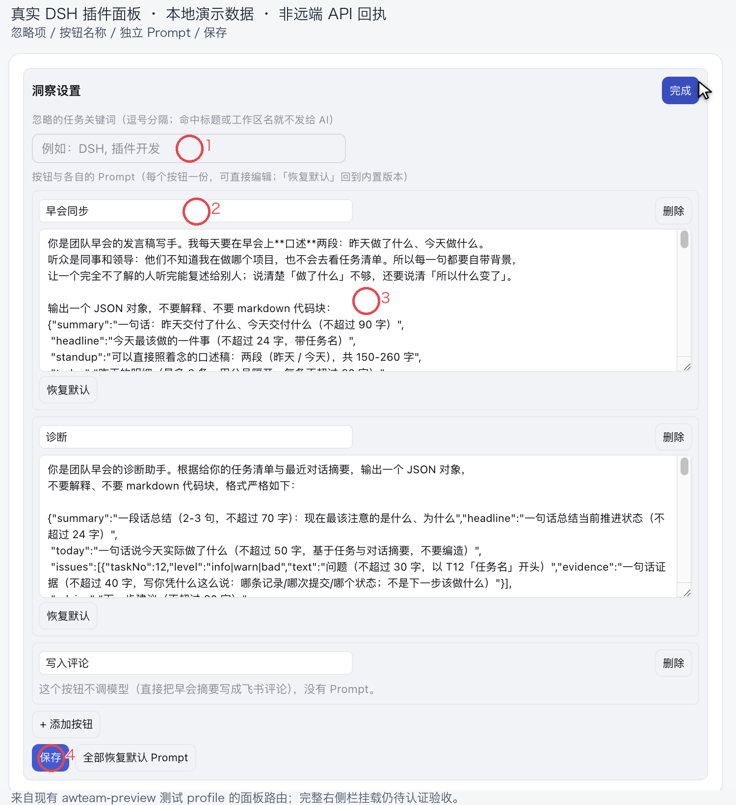

**入口**：洞察卡右上角齿轮。

**怎么用**：修改诊断 Prompt/参考要求并保存，管理最多六个按钮与各自 Prompt，点「完成」回内容页。
按钮有早会、导出、AI 三类；导出只写评论，不生成新判断，AI 按钮按自己的问题诊断。

**为什么**：同一批事实可回答「今天先做什么」或「为什么老延期」，不必再造一张统计面板。

**副作用/边界**：AI 按钮及重新生成会调用模型；导出会写远端评论。
Prompt 影响解读，不允许模型自造指标；版本升级可能迁移旧默认/自定义 Prompt，升级后核对个人追加要求。
当前设置页不提供快捷键编辑，不沿用旧版快捷键输入框说明。
圈注重点：Prompt、按钮类型与文案、保存/完成；不要截图私人提示词材料。

## 14. 任务多文档与 AI 生成

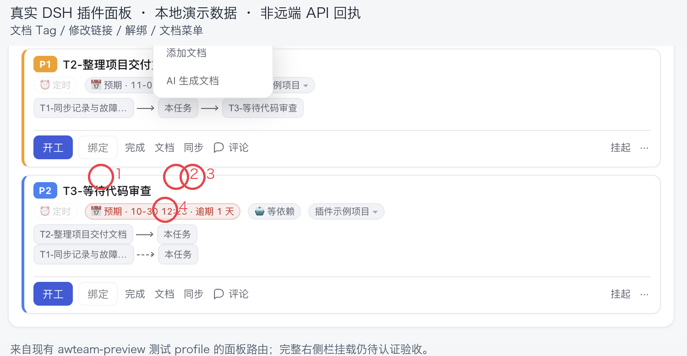

**入口**：任务卡文档 Tag，底栏「文档」菜单 → 添加文档 / AI 生成或更新；「配置」→「文档生成」改 Prompt。

**怎么用**：贴文档链接绑定，已有文档仍可继续添加；点 Tag 打开，编辑/移除在相应管理入口。
一条任务支持多文档，按 URL 去重；本地手动/生成记录有最多八条的保留上限，不是无限附件仓库。
AI 生成使用任务说明与绑定会话最新结论，在飞书「DSH 任务文档」下创建任务目录和 docx。
已有插件生成文档优先原地更新，只保留一篇「自己生成」的记录，外部绑定文档不因此被替换。

**为什么**：把需求、设计与成果都挂到任务上；只更新自己的产出，避免覆盖外部参考资料。

**副作用/边界**：绑定/改链接/解绑写本地并立即尝试重写清单「文档」字段，一行一个链接。
解绑不删除远端文档；写回失败看提示，不能把本地成功当成飞书已更新。描述识别的外部链接另按 URL 展示。
AI 生成/更新会调用模型并写飞书正文；更新可能清空重写，更新失败还可能新建替代文档，操作前核对用途。
当前桥接支持标题、基础富文本、代码和原生表格块；Mermaid 仍是代码文本，不自动变成图片。
插件生成文档可随任务改名联动，手动绑定外部文档不改；不宣称本轮真实渲染或标题 API 已验证。
圈注重点：多文档 Tag、继续添加、AI 生成/更新、文档生成 Prompt。

## 15. 文档监听与按需读取

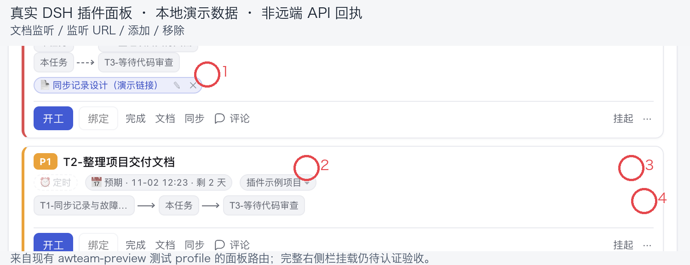

**入口**：「配置」→「文档监听」→ 链接 →「添加监听」；正文阅读可用 `feishu_doc_read`。

**怎么用**：添加需持续跟踪的 wiki/文档链接，同步时抓标题、修改时间与正文摘要；移除则停止监听。
任务绑定与监听是两件事：挂到任务上的文档便于开工引用，监听列表决定定期抓哪些资料。
要读完整材料再按需读取；工具默认返回最多 8000 字符，上限 20000。

**为什么**：常用资料只拉摘要维持上下文，不把所有正文每轮塞进模型。

**副作用/边界**：添加/移除修改设置，同步或正文读取会联网；监听不是飞书实时事件订阅。
资源支持程度取决于链接类型、CLI 与权限；缺权限显示失败，不假装已读。
大文档返回会截断；摘要变化不代表细粒度 diff，监听也不会自动修改远端正文。
圈注重点：监听链接输入、添加、监听项与摘要/时间。

## 16. 会话协作设置与进度回写

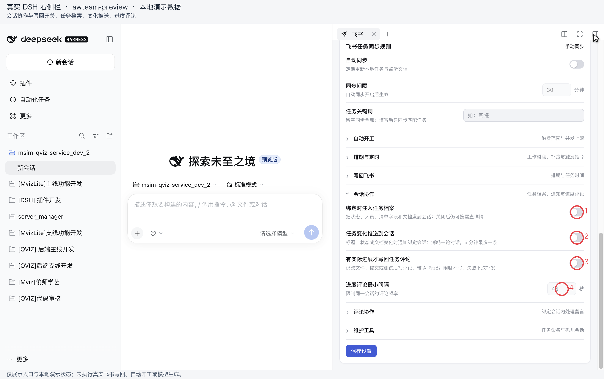

**入口**：「配置」→「同步规则」→「会话协作」「评论协作」。

**怎么用**：需要时开启绑定注入或变化推送；要给同事留进度则开启「有实际进展才写回任务评论」。
进度回写看 turn/end 的文件改动、提交或测试证据，闲聊不写；最小间隔默认 45 秒，可调。
接收评论默认关；开启后分别设置负责人「处理请求」与其他人「仅回复」，并限定每轮处理条数。
首次建立评论历史基线，不执行旧评论；之后按任务 ID + 远端评论 ID 去重，编辑旧评论不自动重做。

**为什么**：档案帮助 agent 了解任务，进度帮助同事了解产出，评论协作让反馈进入原会话，各自开关控制噪音。

**副作用/边界**：注入/推送/评论投递可能产生模型轮次；进度裁切不额外调用模型做摘要，但会真的写飞书评论。
自动进度失败只有限补发，不是无限重试；AI 评论明确标识身份，仍使用已有个人授权账号，不是应用机器人。
常规同步只投递已绑定、未完成、未挂起且可处理的会话；忙碌或未激活时等待，不唤醒冷会话、不新建问答会话。
负责人请求由模型判断意图，普通讨论不应当修改指令；角色、绑定与状态在投递/执行前重核。
非负责人轮次 Host guard 只放行当前任务详情与 `feishu_comment_reply`，不允许运行命令、改文件或读其他会话。
圈注重点：注入/变化/进度三开关、负责人/其他人模式、每轮上限。

## 17. 评论历史、显式处理与收件箱

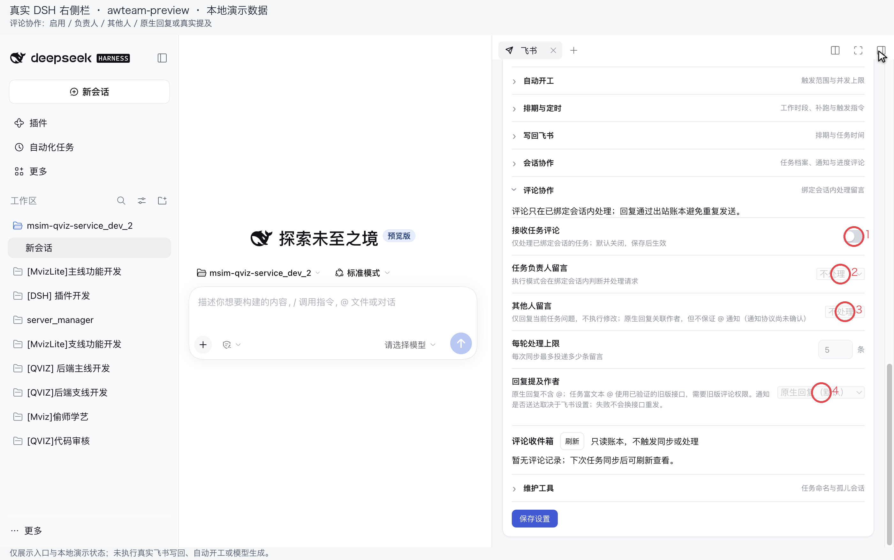

**入口**：任务卡「评论」展开历史；配置中的「评论协作」展开收件箱账本。

**怎么用**：查看/刷新历史只读取，不自动执行；需要执行某条符合条件的评论才点其「处理」。
显式处理投递到原绑定会话，**可能唤醒该会话**，不新建、不换绑；需开启评论协作，任务不能完成或挂起。
历史未读完整、评论已有处理记录等状态会阻止投递；处理进展到原会话查看。
处理轮次显式调用 `feishu_comment_reply`，只允许回复当前投递的 `taskId/commentId`。

**为什么**：把「看留言」和「让 agent 执行」拆开，避免展开面板意外启动工作。

**副作用/边界**：查看远端历史会联网；处理会产生模型轮次，回复是真实写操作。
默认用 Task v2 原生回复关联；显式选 Task v1 富文本 @ 作者需旧版评论权限，不保证通知送达，也不拼假 @姓名。
失败不切通道重发；防循环认出站账本中的远端 ID，不依赖正文 AI 前缀或发言账号。
成功回执缺失/超时置为未知并冻结该任务自动评论；未知出站需管理员核对远端 ID，不能盲目重发。
收件箱可忽略输入或重试确定失败回复，忽略输入不能解除未知出站锁；崩溃恢复保守停止，不保证 exactly-once。
圈注重点：只读刷新、显式处理、原会话入口、账本状态与失败操作。

## 18. 同步记录：查失败与模型触发，不伪造 token 统计

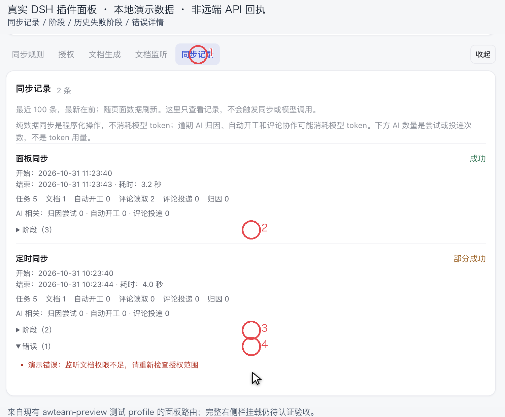

**入口**：「配置」→「同步记录」。

**怎么用**：按最新在前查看最近 100 轮，核对来源、起止/耗时、结果、任务/文档数量及阶段错误。
AI 相关项记录归因尝试、自动开工、评论投递次数；同步未成功时结合卡片的待写/错误提示排查。

**为什么**：分清「没有同步」「某阶段失败」「数据同步成功但触发了 AI」，不靠印象判断成本。

**副作用/边界**：查看记录不触发同步或模型；历史持久化，重启恢复的未完成轮次标为中断。
并发触发合并为一轮，不补造升级前历史；数量是快照/尝试/投递数，不是新增量或精确 token 用量。
单纯拉任务、文档、评论及写快照不调模型，但整轮同步可能尝试归因、开工和协作，因此不保证零 token。
内部已吞掉的子步骤错误可能不在总记录中；阶段成功不等于每个远端字段都已落地。
圈注重点：轮次来源与结果、阶段详情、AI 相关计数和只读说明。

## 模型工具与副作用速查

工具名称是对话入口，不是「除写评论外全只读」的白名单。以下按有效行为区分：

| 工具/动作 | 行为与边界 |
| --- | --- |
| `feishu_tasks` | 默认读本地快照；`refresh=true` 先同步，含同步副作用 |
| `feishu_task_detail` | 读当前/指定任务详情，补拉评论/子任务/附件；120 秒缓存，`refresh` 跳过缓存 |
| `feishu_doc_read` | 联网读一篇文档，可能截断；不写正文 |
| `feishu_sync` | 联网同步并写状态，可能写回字段、归因或开工/评论投递 |
| `feishu_task_session` | `get/list` 查看；`bind/unbind` 写绑定并可能联动命名/时间 |
| `feishu_task_create` | 创建远端任务；默认绑定当前会话，`followUp` 保留原绑定 |
| `feishu_task_report` | 写评论；`complete=true` 另置任务完成，不能当普通查询 |
| `feishu_task_comment` / `feishu_comment_reply` | 写远端评论；后者仅限当前投递评论 |
| `feishu_task_doc` | 绑定/解绑文档关系并写清单字段，不删除远端文档 |
| `feishu_task_relations` | `get` 查看，`refresh` 联网；`suggest` 调 AI，`set` 写关系 |
| `feishu_task_schedule` | `preview/list` 查看；`set/clear` 写 DSH 自动化，可写飞书开始；`pause/resume` 不支持 |
| `feishu_plan_today` | `preview` 候选/时间块；`commit` 写自动化，可能部分任务未排上 |
| `feishu_task_eta` | `preview/list` 查看；`set/clear` 写预期与履约记录，可写远端列 |
| `feishu_task_suspend` | `status` 查看；`suspend/resume` 归档/恢复会话、调整自动化及处理状态 |
| `feishu_insight` | 无有效缓存时生成模型判断；`force` 重生成，`refresh` 先同步 |

任务详情各段独立降级，缺 scope 会说明读取失败，不把空结果伪装成「没有评论/附件」。
任务清单自定义字段与多维表格不同；本插件没有 Bitable 记录关联存储能力。

## 本地数据、维护与安全

数据目录是 `<DSH_HOME>/dsh-feishu/`，默认 DSH_HOME 为 `~/.dsh`：

| 文件/存储 | 保存什么 |
| --- | --- |
| `settings.json` | 同步、开工、字段映射、Prompt、监听与协作设置 |
| `state.json` | 任务/文档快照、绑定、编号、工作区、履约、待写、洞察、同步历史等 |
| `comments.json` | 评论收件箱、处理状态与出站账本，独立于任务快照 |
| `metrics.jsonl` | 每日指标快照；不是模型 token 账单 |
| 浏览器 localStorage | 当前筛选、自定义/覆盖模板等浏览器侧偏好 |

**一个 DSH_HOME 只有一份 `state.json`，不按端口分文件。** 首次必要时从最近旧状态迁移，旧文件留备份。
端口变化不应成为重新编号/重绑理由；多个进程共享同一 DSH_HOME 仍可能全量覆盖、丢更新，建议只跑一个实例。
隔离测试要隔离 DSH_HOME，不只是换端口或 profile 名；复制状态种子不得保留真实个人资料和有效授权。
CLI 凭据由 `feishu-sync` 管理，常见于 `~/.feishu/`；桥接复用同一 token，不另建授权库。
评论账本原子替换并有进程锁，异常锁须人工核对；不承诺断电安全或远端 exactly-once。

「同步规则」→「维护工具」可统一历史任务命名，或扫描孤儿会话后确认归档。
统一命名会写真实任务标题，专用批量入口不联动所有会话名；孤儿清理只归档，不删除会话目录。
不要用维护按钮来测试个人清单；有权限也不等于有用户执行授权。

HTTP 面板与 API 挂在宿主同域 `/dsh-feishu` 前缀，未额外增加插件级鉴权；不要当成安全的公共服务暴露。
本机监听不防范其他本机进程；若宿主允许远端访问，必须由部署层补足访问控制。
权限不足会降级/报错；任务字段、文档、评论的写权限以及会话运行权限需要分别考虑。
清单字段常需 `task:custom_field:read` / `task:custom_field:write`，评论读取需 `task:comment:read`；写评论、依赖和文档另按所用接口申请权限。
Task v1 富文本提及需对应旧版评论权限；授权成功不代表已授所有 scope，也不代表可编辑每个关联任务或文档。
日志和截图需脱敏姓名、头像、任务内容、工作区路径、评论、文档 URL、OAuth 查询参数与授权码。
AI 会收到选取的任务/会话材料；发送前评估机密性，不把评论中的外部文本当作提升权限的指令。

## 验证状态与可复现检查

本轮重写指南并加入十八张圈注图。实际完成：登录已有 `awteam-preview`、打开右侧栏、从指南入口添加「飞书」、确认同源 iframe 和当前会话上下文、展开配置/关系/预期/工作区/筛选/文档等入口。没有将直接面板截图冒充右侧栏总览，详见 [截图拍摄记录](docs/shots/v020/README.md)。
首次临时挂载触发默认同步，CLI 在本地缓存初始化失败，未得到任务数据；随后停止实例、写入关闭自动同步/开工/评论的演示设置并重启。没有完成真实飞书读写验证，不把失败尝试称为成功同步；已绑定任务、真实评论和提醒投递仍需专用任务清单验收。
`npm run test:offline` 已通过（35 个 JavaScript 测试文件、5 个 Python 套件）；PNG 文件可解码，圈注来自 DOM/可访问性树坐标。当前截图模型不支持图像输入，尚无像素级视觉复核。图片和说明已写入仓库文件，未上传外部图床、未推送远端。

| 检查入口（在包目录执行） | 范围与风险 |
| --- | --- |
| `npm run test:offline` | 排除真实 smoke；隔离 mock 的 JS/Python 回归，不调用真实 CLI/API |
| `npm run test:client` | 客户端模块注册、侧边栏接线与缺依赖降级，不代表像素/点击链路验证 |
| `npm run test:smoke` | 旧 smoke 含个人授权下真实 CLI 同步，不适合无授权/无写回许可的检查 |
| `npm test` | 含上述真实 smoke，不能称为全部离线；部分回归需要 `python3` 与 `cc` |

真实验收应在专用清单逐项确认：授权与 scope、右侧栏挂载、绑定/开工、定时记录与投递、文档/关系写回、评论账本。
只记录实际做到的步骤、命令与远端回执；UI 展示、fake 测试与真实 API 验证分开报告。
Host 改动后核对加载版本再测；刷新旧面板、旧版本验证文档或既有截图不能替代本轮证据。

深入设计可参考 [功能契约](CONTRACT.md)、[工作区绑定设计](docs/DESIGN-workspace-binding.md)、[任务生命周期设计](docs/DESIGN-task-lifecycle.md)。
历史 [排期设计](docs/DESIGN-ai-scheduling.md) 与 [使用指南](docs/USER-GUIDE.md) 可能保留旧本地调度/单文档说明，当前使用边界以本指南与现行实现为准。

## 许可证

MIT。第三方 DSH、CLI 与飞书服务各自遵守其许可、授权和使用条款。
