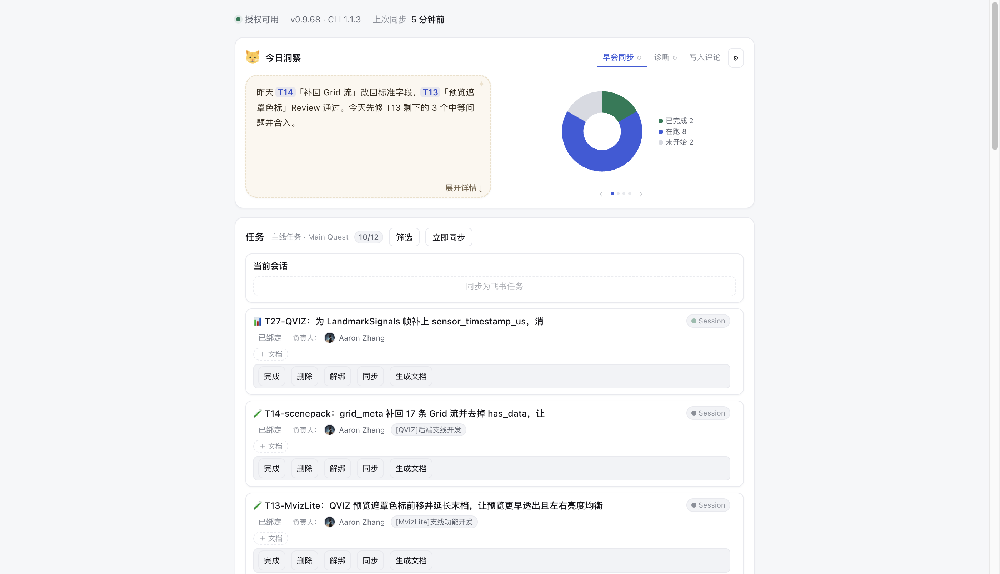
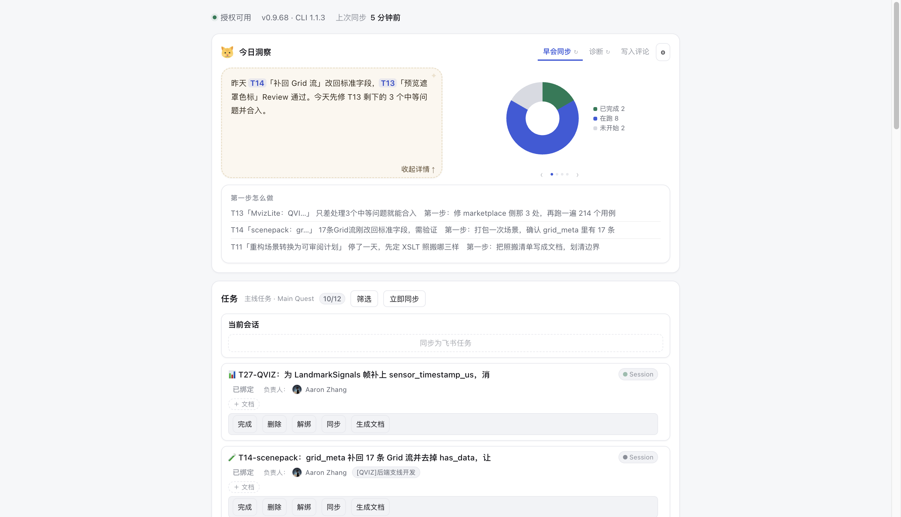
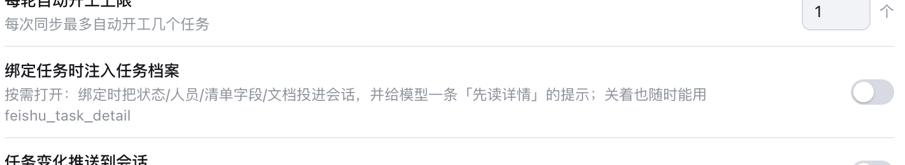
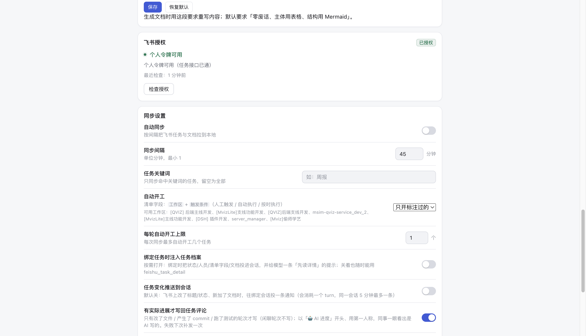
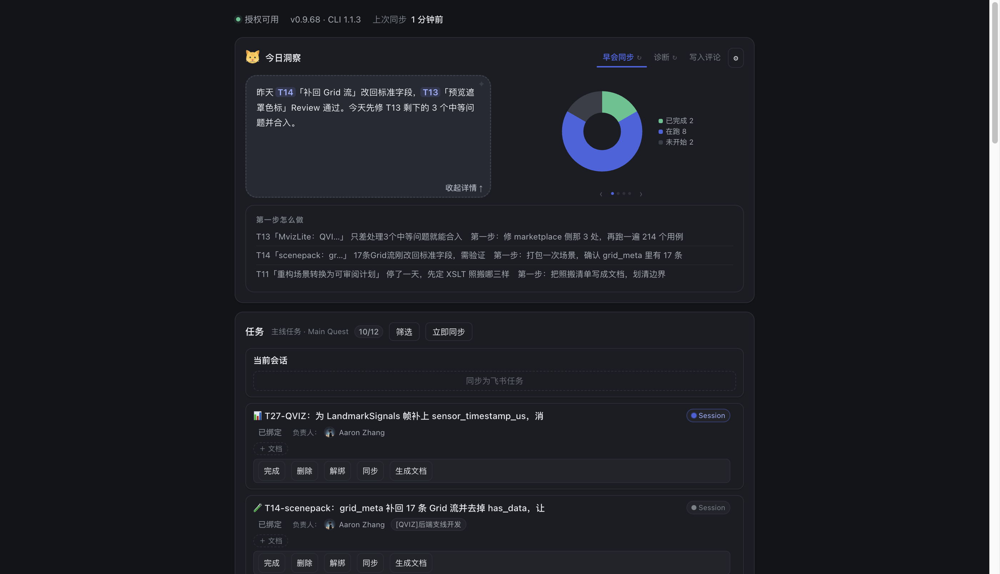

# DSH 飞书插件 · 使用说明

把飞书任务清单搬进 DSH：每条任务一张卡，绑定一条会话；每天开工前先看一眼「今日洞察」，知道先做哪件、不碰什么。

---

## 1. 面板在哪儿

DSH 侧边栏的「飞书」面板。上面是今日洞察，下面是任务列表。

---

## 2. 今日洞察

**左边**是 AI 说的一句话：昨天做了什么、今天最该做哪件。
**右边**是图表，用 `‹` `›` 切换（状态分布 / 工作区分布 / WIP 趋势）。

- 右上角是两个 **tab**：`早会同步`、`诊断`。切 tab 只换视图，不重新生成。
- 每个 tab 自带的 `↻` 才是「重新生成」，只跑当前这个 tab 的提示词。
- 点气泡右下角 `展开详情`，看每条任务的第一步该怎么做。

---

## 3. 任务卡

一行标题，超长自动省略，鼠标悬停看全名。

**`Session` 按钮上的那盏灯**，就是会话状态：

| 灯 | 含义 |
| --- | --- |
| 蓝色呼吸 | 这条对话正在回复 |
| 绿色实心 | 跑完了，还没看 |
| 绿色淡 | 空闲，已看过 |
| 灰色 | 会话已结束 |

卡片底部的动作：`完成`（置完成 + 归档会话）、`删除`（只归档会话）、`解绑`、`同步`、`生成文档`。

---

## 4. 设置

点洞察卡右上角 `⚙`：

- 每个 tab 的文字和 prompt 都能改，改完点 `完成` 才生效
- 「忽略的任务关键词」：命中的任务不发给 AI（默认忽略 `DSH`）

---

## 5. 深色模式

跟随 DSH 主题，洞察气泡、图表、任务卡都有一套深色配色。

---

## 6. 常见问题

**「已完成」筛选为什么是空的？**
飞书的已完成历史不再同步（几百条会把列表撑爆）。这里只显示**你在面板里标完成**的任务，连同它绑定的会话一起留着。

**洞察一直是空的？**
当天第一次打开会自动生成一次，约 15 秒。之后切对话、重开面板都不会再跑模型，只有点 tab 上的 `↻` 才会重新生成。

**任务为什么显示「进行中」而不是「未开工」？**
只要绑了一条会话就算进行中。没写代码、只是在讨论，也算在推进——只是还没收口。

**为什么洞察里会提到 T13 这种编号？**
每条建议都会带上任务名：`T13「预览遮罩色标」`。编号只是索引，名字才是你能认出来的部分。
