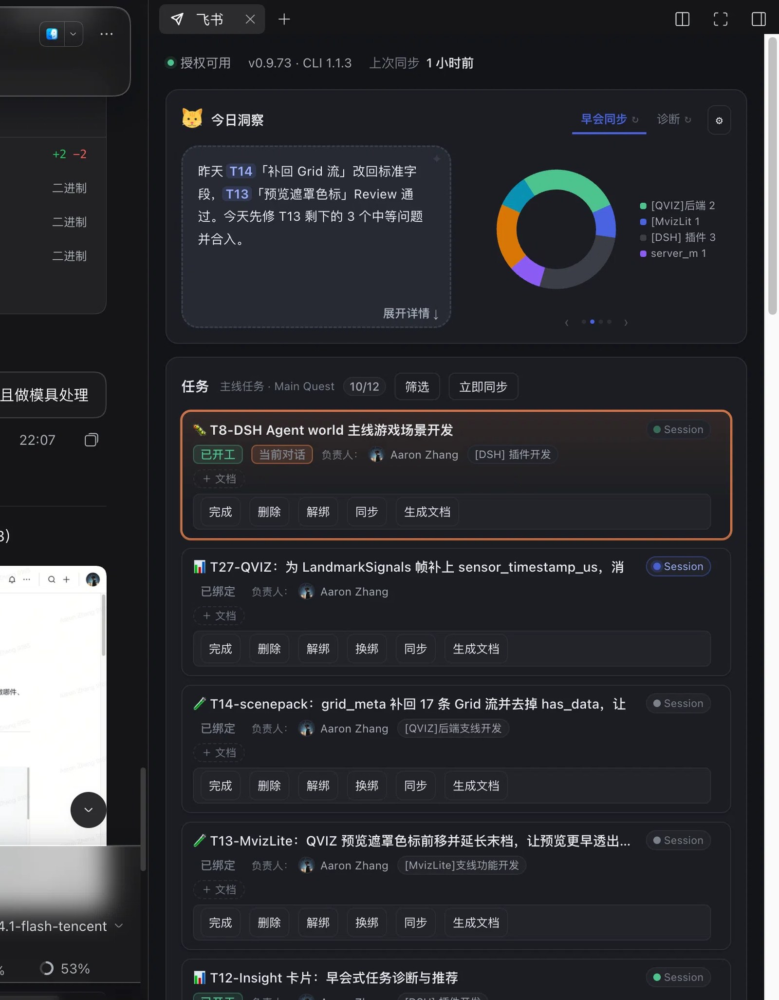
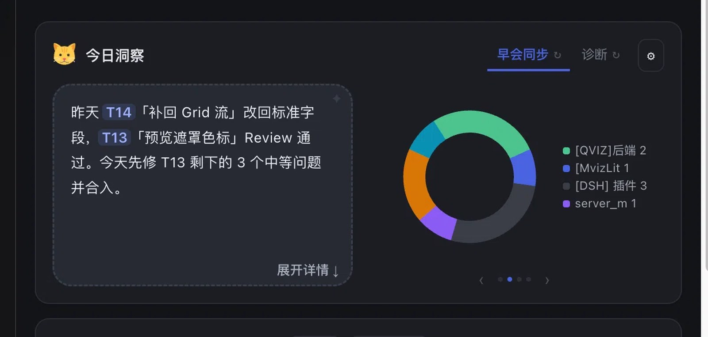
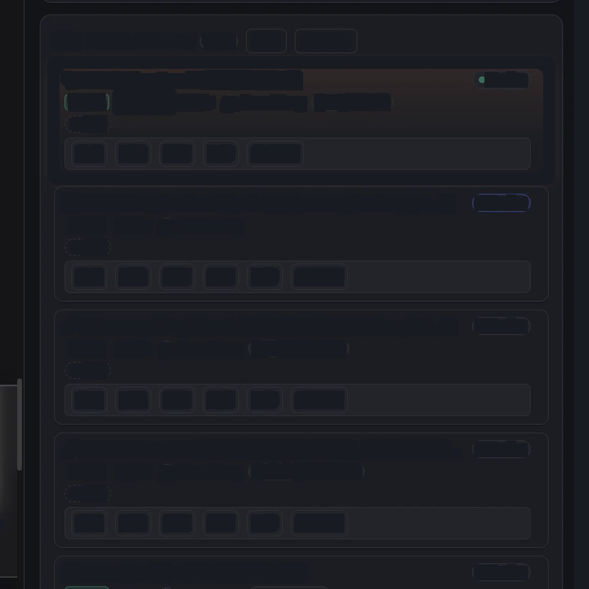
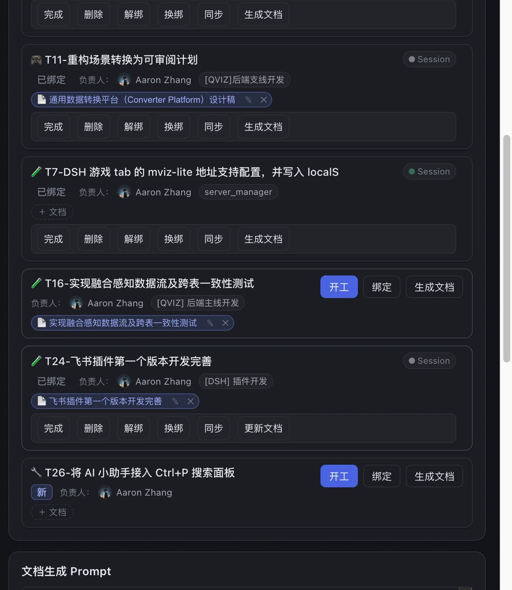
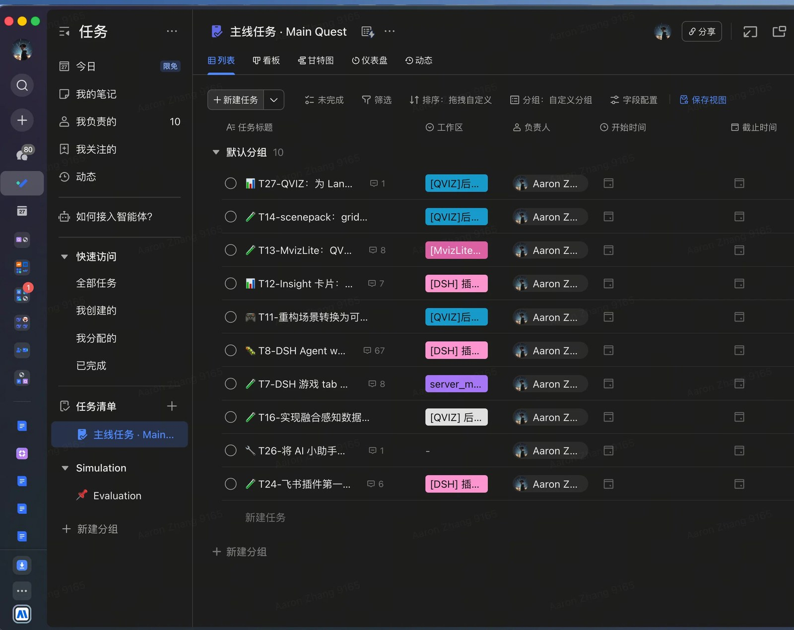

# DSH 飞书插件 · 使用说明

把飞书任务清单搬进 DSH：每条任务一张卡，绑定一条对话；每天开工前先看一眼「今日洞察」，知道先做哪件、不碰什么。

> 截图已脱敏：所有文字与图表数值都打成色块，只看布局与控件位置。

---

## 1. 面板在哪儿

面板和对话并排放在同一屏：左边干活，右边看任务；点任务卡的 `Session` 就能跳到对应的对话。

---

## 2. 今日洞察

**左边**是 AI 说的一句话：昨天做了什么、今天最该做哪件。
**右边**是图表，用 `‹` `›` 切换（状态分布 / 工作区分布 / WIP 趋势）。

- 右上角两个 **tab**：`早会同步`、`诊断`。切 tab 只换视图，**不会**重新生成。
- 每个 tab 自带的 `↻` 才是「重新生成」，只跑当前这个 tab 的提示词。
- 卡片标题前那只猫是 AI 形象，会跟着主题呼吸。

---

## 3. 任务列表

一行标题，超长省略、悬停看全名，双击就地改名。

**`Session` 按钮上的那盏灯**：

| 灯 | 含义 |
| --- | --- |
| 蓝色呼吸 | 这条对话正在回复 |
| 绿色实心 | 跑完了，还没看 |
| 绿色淡 | 空闲，已看过 |
| 灰色 | 会话已结束 |

---

## 4. 优先级

清单里有一个单选字段「优先级」，值就是 `P0`~`P3`。

- 卡片**左边一条色条** + 标题前**实心徽标**：红 P0 / 橙 P1 / 蓝 P2 / 灰 P3
- 点徽标弹出选择器，选完**立刻写回飞书**
- 没设过的卡片是虚线 `--`，点一下就补
- 列表排序：**当前对话那条永远置顶**，其余按 P0 → P3 → 未设置

## 4. 任务卡

| 元素 | 说明 |
| --- | --- |
| `＋ 文档` | 把对话里的文档挂到这条任务 |
| 完成 | 飞书置完成 + 归档会话 |
| 删除 | 只归档会话，任务状态不变 |
| 解绑 | 只断开关联，任务回到未开工 |
| 同步 | 按最后修改时间决定写回还是拉取 |
| 生成文档 | 为该任务建一篇飞书文档 |

---

## 4.5 排期：让它到点自己开工

任务卡信息行里有一枚 `⏰ 定时` 按钮（就是下面说的「排期」）：

- **没有排期**时是虚线 `⏰ 定时`，点开就能排；
- **有排期**时只显示两段：**规则 + 下次**。例如 `⏰ 每周一 09:30 · 11-02`、
  `⏰ 每天 09:00 · 明天`、`⏰ 每 1 小时 · 今天`。
  几点已经在规则里，下次段就只写日期；一次性没有规则段，直接写 `⏰ 明天 15:00`。
  已暂停收个 `⏸️`；免打扰、只在某时段这些细节在悬停里。

点开后只有一件事要做：**用一句话说时间**。

| 你可以写 | 它会理解成 |
| --- | --- |
| 明天下午三点 | 明天 15:00 一次性 |
| 30 分钟后 / 半小时后 | 从现在起算 |
| 每周一早上九点半 | 每周一 09:30（跑完自动排下一次） |
| 工作日 9:00 | 周一到周五 09:00 |
| 每月 1 号 10:00 | 每月 1 日 |
| 截止前 2 小时 | 相对任务截止时间 |
| 每天 9:00，午休别打扰 | 顺带加 12:00-13:30 免打扰 |
| 每隔一小时 / 每小时 / 每 30 分钟 / 每半小时 | 间隔型，从创建那一刻起算（最短 5 分钟） |

到点发给会话的那句话在「设置 → 时间自动化 → 定时触发时发什么指令」里改，
默认是「继续这条任务：先制定计划，然后按计划开始执行。」——写得模糊一点通常更好，
Agent 就在自己的会话里，上下文都在，它需要的是「接着干」，不是重新交代一遍任务。

> **这条时间存在哪？** 只存在 DSH 的自动化任务里。
> 所以必须先绑定会话：任务还没绑定会话时，`⏰ 定时` 是禁用态，点了会提示先开工/绑定。
> 一个会话只有一条自动化：你在 DSH 的「自动化」里建的那条，就是这里显示的那条；改这里就是改它。

写错也没关系：点「预览」会先把「下次什么时候」算给你看，再点「保存」才真的落地。
保存后默认会把这次时间**写回飞书的开始时间**，在手机飞书里也能收到提醒。

也不一定自己动手——在对话里说「把周报排到每周一早上九点半」「今天帮我安排一下」，
模型会调 `feishu_task_schedule` / `feishu_plan_today` 把话变成排期。

**到点会怎样？** 到点自动开工（新建会话，和手动点「开工」是同一条路）。
要是那会儿电脑睡了、DSH 没开，就按设置里的「错过策略」处理：
宽限内补跑（默认）／跳过／顺延下一次。

**不想它自己开工？** 排期是显式授权，不受「自动开工」三档总开关影响；
不想要就把排期清掉（浮层里的「清除」），或者在设置里把「自动开工」关掉、只用它看时间。

---

## 4.6 预期完成：让承诺可衡量

任务卡上有一枚 `📅 预期`：没设时就是「预期」，设了显示 `📅 预期 · 10-30 18:00 · 剩 2 天`。

> 和 `⏰ 定时` 的区别：定时是「什么时候做」（到点推一条指令），预期是「什么时候交」（承诺）。

- 点开输入一句话：`这周五 18:00`、`明天下午三点`、`10-30`（只给日期时算当天 18:00）。
- 开始时间跟着「绑定会话」自动记（不用你填），结束时间在标完成时自动记；
  这两个**不在卡片上显示**，只在飞书任务里能看到。
- 往后改预期会记一条延期；到期没完成会显示「逾期 N 天」。
- 完成后显示结果：提前 / 准时 / 延期 N 天。
- **同一份时间只显示一遍**：写回飞书的「预期完成」列、排期写回的开始时间，
  都不再单独成一枚灰 chip——卡片上只留带图标的 `📅 预期` / `⏰ 定时`，点它们就能改。

它解决的是「答应的有没有做到」：洞察卡里会多一行履约摘要（准时率、平均偏差、逾期数、改期次数）。

---

## 4.7 工作区和任务的关系

飞书任务上的「工作区」是一个**名字**（单选字段），但插件记住的是工作区的 **id**：

- 在 DSH 里给工作区**改名**不会断链——下一轮同步会按 id 认出来，并把新名字写回飞书；
- 名字相同、目录不同的两个工作区不会互相串（id 才是主键）；
- 认不出来时不会「猜一个差不多的」：卡片会标红说「没找到工作区」，让人重选；
- 如果你在字段里写了一个**还没登记的绝对路径**，卡片上会出现「登记为工作区」按钮，
  点一下就在 DSH 里登记并绑定；
- **换工作区不用去飞书**：点卡片上的工作区标签会下拉出已登记的工作区（带路径），
  选一个就换绑，并立刻把新名字写回飞书的「工作区」字段。

> 老数据不用管：第一次同步成功解析后就会把 id 记下来。

---

### 逾期会被自动归因

预期时间过了还没完成，插件会让 AI 结合「最近对话 + 改期记录 + 最后活动」给出一个归因
（估时不准 / 等依赖 / 需求变了 / 被打断 / 环境权限 / 返工验收 / 其他），显示成预期芯片旁边的
`🤖 估时不准`，悬停能看到理由和依据。改期之后旧归因会自动作废、重新算一次。
人工写过的改期原因永远优先，AI 不覆盖。

## 5. 任务看板

按状态/优先级筛、按工作区分组，和飞书那边的清单是同一批数据。

---

## 6. 常见问题

**「已完成」筛选为什么是空的？**
飞书的已完成历史不再同步（几百条会把列表撑爆）。这里只显示**你在面板里标完成**的任务，连同它绑定的会话一起留着。

**洞察一直是空的？**
当天第一次打开会自动生成一次，约 15 秒。之后切对话、重开面板都不会再跑模型，只有点 tab 上的 `↻` 才会重新生成。

**为什么显示「进行中」而不是「未开工」？**
只要绑了一条会话就算进行中。没写代码、只是在讨论，也算在推进——只是还没收口。

**为什么洞察里会提到 T13 这种编号？**
每条建议都带任务名：`T13「预览遮罩色标」`。编号只是索引，名字才是你能认出来的部分。
